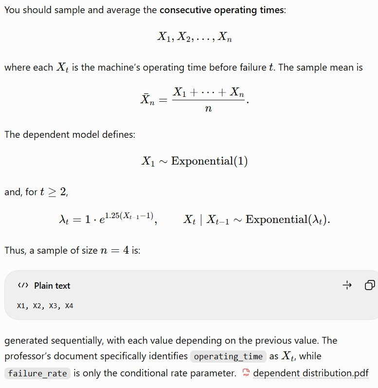
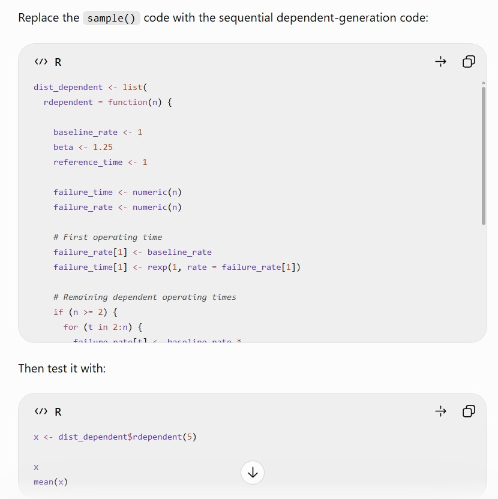

```{r}
#| label: setup
#| include: false
library(ggplot2)
library(gt)
library(scales)
library(knitr)

# ---- Load the population generators from the simulation scripts -------------
gens <- tryCatch({
  source("scripts/config.R")
  source("scripts/distributions.R")
  c(dist_normal, dist_uniform, dist_die, dist_exponential,
    dist_poisson, dist_binom_small, dist_binom_large, dist_cauchy, dist_death,
    dist_dependent, dist_nonidentical)
}, error = function(e) {
  message("Could not load scripts/: ", conditionMessage(e))
  list()
})

# ---- Settings ----------------------------------------------------------------
R           <- 10000                         # Monte Carlo repetitions (match main.R)
results_dir <- "results"                     # stats_results_<name>.csv live here
fig_dir     <- file.path(results_dir, "figures")  # <name>_hist_n<n>.png / <name>_qq_n<n>.png
N_POP       <- 50000                         # draws used to display each population
skew_tol    <- 0.5                           # normal enough: |skewness| <= 0.10
kurt_tol    <- 1                             # and |Pearson kurtosis - 3| <= 0.20

navy <- "#12263f"; blue <- "#1b4f72"; accent <- "#c8553d"; grey <- "#616e7c"

# ---- Distributions (order = order of the report) -----------------------------
meta <- data.frame(
  dist = c("normal",
           "uniform",
           "die",
           "exponential",
           "poisson",
           "binomial_small",
           "binomial_large",
           "cauchy",
           "rdeath",                      # name used by dist_death in distributions.R
           "rdependent",                  # name used by dist_dependent
           "rnonidentical"                # name used by dist_nonidentical
           ),
  label = c("Normal(0, 1)",
            "Uniform(0, 1)",
            "Six-sided die",
            "Exponential(1)",
            "Poisson(1)",
            "Small Binomial(5, 0.10)",
            "Large Binomial(20, 0.50)",
            "Cauchy(0, 1)",
            "Age at death (bimodal)",
            "Machine failure (dependent)",
            "Basketball shots (non-identical)"
            ),
  params = c("\u03bc = 0, \u03c3 = 1",
             "a = 0, b = 1",
             "Values 1\u20136, equally likely",
             "\u03bb = 1 (mean = 1)",
             "\u03bb = 1 (mean = 1)",
             "size = 5, p = 0.10",
             "size = 20, p = 0.50",
             "location = 0, scale = 1",
             "Ages 0\u2013100; exponential decay (rate 1/5) plus a normal bump centred at 65 (SD 10)",
             "Exponential times; each rate depends on the previous time: \u03bb\u209c = exp(1.25 (X\u209c\u208b\u2081 \u2212 1)), \u03bb\u2081 = 1",
             "Shots made in a 20-shot game; p falls linearly from 0.90 (shot 1) to 0.50 (shot 20)"
             ),
  gen = c("rnorm(n, 0, 1)",
          "runif(n, 0, 1)",
          "sample(1:6, n, replace = TRUE)",
          "rexp(n, rate = 1)",
          "rpois(n, lambda = 1)",
          "rbinom(n, size = 5, prob = 0.10)",
          "rbinom(n, size = 20, prob = 0.50)",
          "rcauchy(n, location = 0, scale = 1)",
          "sample(0:100, n, replace = TRUE, prob = death_distribution$probability)",
          "rexp(1, rate = exp(1.25 * (x[t - 1] - 1))), one time after another",
          "colSums(matrix(rbinom(n * 20, 1, prob = rep(p, n)), nrow = 20))"
          ),
  trait = c("Normal",
            "Bounded, symmetric, non-normal",
            "Discrete uniform",
            "Strong right skewed",
            "Discrete, right skewed",
            "Discrete, strongly right skewed",
            "Discrete, symmetric",
            "Heavy-tailed, no finite mean or variance",
            "Bimodal, discrete",
            "Dependent observations, right skewed",
            "Non-identical Bernoulli trials, discrete"
            ),
  discrete = c(FALSE, FALSE, TRUE, FALSE, TRUE, TRUE, TRUE, FALSE, TRUE, FALSE, TRUE),
  stringsAsFactors = FALSE
)

# ---- Load the simulation results ---------------------------------------------
files <- list.files(results_dir, pattern = "^stats_results_.*\\.csv$", full.names = TRUE)
stopifnot("No stats_results_*.csv files found in results/. Run scripts/main.R first." = length(files) > 0)
res <- do.call(rbind, lapply(files, function(f) {
  d <- read.csv(f)
  # Every statistic must be numeric. If a file has text in a column (e.g. a stray header
  # row or a hand-edited cell), say which file, coerce to numeric and drop unusable rows.
  num <- setdiff(names(d), "dist")
  bad <- num[!vapply(d[num], is.numeric, logical(1))]
  if (length(bad)) {
    message(basename(f), ": non-numeric column(s) ", paste(bad, collapse = ", "),
            " (e.g. '", paste(head(unique(unlist(lapply(d[bad], as.character))), 3), collapse = "', '"),
            "'). Coercing to numeric; check this file.")
    d[bad] <- lapply(d[bad], function(v) suppressWarnings(as.numeric(as.character(v))))
  }
  if (!"n" %in% names(d)) stop(basename(f), " has no 'n' column")
  d <- d[!is.na(d$n), , drop = FALSE]
  d$dist <- sub("^stats_results_(.*)\\.csv$", "\\1", basename(f))
  d
}))
res <- merge(res, meta[, c("dist", "label")], by = "dist", all.x = TRUE)
res <- res[res$dist %in% meta$dist, , drop = FALSE]
res$label[is.na(res$label)] <- res$dist[is.na(res$label)]
res <- res[order(match(res$dist, meta$dist), res$n), ]
res$normal_enough <- abs(res$Skewness) <= skew_tol & abs(res$Kurtosis - 3) <= kurt_tol

# Smallest n that is normal enough and stays so for all larger n tested
stable_n <- function(d) {
  d <- d[order(d$n), ]
  ok <- sapply(seq_len(nrow(d)), function(i) all(d$normal_enough[i:nrow(d)]))
  if (any(ok, na.rm = TRUE)) min(d$n[which(ok)]) else NA_real_
}

# ---- Theoretical (or simulated) population mean and SD ----------------------
pop_draws <- lapply(setNames(meta$dist, meta$dist), function(d) {
  g <- gens[[d]]
  if (is.null(g)) return(NULL)
  tryCatch(as.numeric(g(N_POP)), error = function(e) NULL)
})
exact <- list(normal = c(0, 1), uniform = c(0.5, sqrt(1 / 12)), die = c(3.5, sqrt(35 / 12)),
              exponential = c(1, 1), poisson = c(1, 1),
              binomial_small = c(0.5, sqrt(5 * 0.10 * 0.90)),
              binomial_large = c(10, sqrt(20 * 0.50 * 0.50)),
              cauchy = c(NA_real_, NA_real_))               # no finite mean or variance
pp <- seq(0.90, 0.50, length.out = 20)                      # shot probabilities used by dist_nonidentical
exact$rnonidentical <- c(sum(pp), sqrt(sum(pp * (1 - pp))))   # mean and SD of shots made per game
# rdependent has no closed form: its mean and SD are simulated (falls back to pop_draws)
if (exists("death_distribution")) {                         # exact moments of the age-at-death pmf
  mu_d <- sum(death_distribution$age * death_distribution$probability)
  exact$rdeath <- c(mu_d, sqrt(sum((death_distribution$age - mu_d)^2 * death_distribution$probability)))
}
pop_info <- do.call(rbind, lapply(meta$dist, function(d) {
  if (!is.null(exact[[d]]))
    return(data.frame(dist = d, mu = exact[[d]][1], sigma = exact[[d]][2], src = "exact"))
  x <- pop_draws[[d]]
  if (is.null(x))
    return(data.frame(dist = d, mu = NA_real_, sigma = NA_real_, src = "unavailable"))
  data.frame(dist = d, mu = mean(x), sigma = sd(x), src = "simulated")
}))

# ---- Shared helpers ------------------------------------------------------------
theme_conf <- function(base = 12) {
  theme_minimal(base_size = base, base_family = "sans") +
    theme(
      plot.title      = element_text(face = "bold", colour = navy, size = base + 2),
      plot.subtitle   = element_text(colour = grey, margin = margin(b = 8)),
      axis.title      = element_text(colour = grey, size = base - 1),
      axis.text       = element_text(colour = "#3e4c59"),
      panel.grid.minor = element_blank(),
      panel.grid.major = element_line(colour = "#e4e7eb", linewidth = .3),
      strip.text      = element_text(face = "bold", colour = navy, hjust = 0),
      strip.background = element_blank(),
      legend.position = "bottom",
      legend.title    = element_blank(),
      plot.title.position = "plot"
    )
}

style_gt <- function(g, size = 13) {
  g |>
    tab_options(table.font.size = px(size),
                column_labels.background.color = navy,
                row_group.background.color = "#eef2f7",
                row_group.font.weight = "bold",
                table.width = pct(100),
                data_row.padding = px(4)) |>
    tab_style(style = cell_text(color = "white", weight = "bold"),
              locations = cells_column_labels())
}

# p-values as text so very small values never break a table
fmt_p <- function(p) ifelse(is.na(p), "—", ifelse(p < 0.001, "<0.001", sprintf("%.3f", p)))
p_cols <- c("SW_p", "Lillie_p", "AD_p", "DP_p")
stat_cols <- c("SW_W", "Lillie_D", "AD_A", "DP_Chi2")   # test statistics (used in the all-statistics table)

col_labels <- c(label = "Distribution", n = "n", Mean = "Mean", Median = "Median",
                SD = "SD (sim. SE)", Skewness = "Skew", Z_s = "Z skew",
                Kurtosis = "Kurt", Z_k = "Z kurt", SW_p = "Shapiro p",
                Lillie_p = "Lilliefors p", AD_p = "A–D p", DP_p = "D'Ag.–P. p",
                SW_W = "Shapiro–Wilk W", Lillie_D = "Lilliefors D", AD_A = "Anderson–Darling A",
                DP_Chi2 = "D'Ag.–P. χ²",
                Ok = "Normal enough?")

# ---- Choose which n to show in each distribution's histogram/Q-Q/table -------
pick_n <- function(d) {
  ns <- sort(unique(res$n[res$dist == d]))
  if (length(ns) <= 4) return(ns)
  sort(unique(c(min(ns), ns[which.min(abs(ns - 30))], ns[ceiling(length(ns) / 2)], max(ns))))
}

n_show_plot <- list(
  normal         = c(1),
  uniform        = c(2, 7, 10),
  die            = c(2, 4, 12, 34),
  exponential    = c(14, 34, 100, 1000),
  poisson        = c(18, 30, 500),
  binomial_small = c(10, 27, 500),
  binomial_large = c(2),
  cauchy         = c(800),
  rdeath         = c(2, 7, 20),
  rdependent     = c(26, 66, 191, 500),
  rnonidentical  = c(3, 10)
)
n_show_table <- list(
  normal         = c(1, 5, 20),
  uniform        = c(2:10),
  die            = c(2, 4, 12, 20, 30, 34),
  exponential    = c(10, 14, 24, 30, 32, 34, 36, 100, 300, 600, 1000),
  poisson        = c(4, 17, 18, 19, 28, 30, 32, 34, 100, 250, 500),
  binomial_small = c(6, 27, 200, 500),
  binomial_large = c(1, 2, 3, 5, 10),
  cauchy         = c(100, 300, 500, 800),
  rdeath         = c(2, 7, 20, 200, 300, 400),
  rdependent     = c(26, 66, 191, 201, 401, 500),
  rnonidentical  = c(1, 3, 10, 20)
)
get_n_plot  <- function(d) if (!is.null(n_show_plot[[d]]))  n_show_plot[[d]]  else pick_n(d)
get_n_table <- function(d) if (!is.null(n_show_table[[d]])) n_show_table[[d]] else pick_n(d)
```

```{r}
#| label: plot-helpers
#| include: false

# Population plot: a large simulated draw from the generator, with mu and sigma in the subtitle
plot_population <- function(d) {
  x <- pop_draws[[d]]
  if (is.null(x))
    return(ggplot() + theme_void() +
             labs(title = "Population draws unavailable (check that scripts/ loads)"))
  info <- pop_info[pop_info$dist == d, ]
  lab  <- meta$label[meta$dist == d]
  disc <- meta$discrete[meta$dist == d]
  sub  <- if (is.na(info$mu)) "Mean undefined (no finite mean); display clipped to [-20, 20]"
          else sprintf("μ = %.3f, σ = %.3f (%s)", info$mu, info$sigma, info$src)
  if (is.na(info$mu)) x <- x[abs(x) <= 20]        # undefined mean: clip the display window
  p <- ggplot(data.frame(x = x), aes(x))
  p <- if (disc) p + geom_bar(aes(y = after_stat(prop), group = 1), fill = blue, width = 0.8)
       else p + geom_histogram(aes(y = after_stat(density)), bins = 60, fill = blue,
                               colour = "white", linewidth = .2)
  if (!is.na(info$mu)) p <- p + geom_vline(xintercept = info$mu, colour = accent,
                                           linetype = 2, linewidth = .8)
  p + labs(title = paste("Population:", lab), subtitle = sub, x = "Value",
           y = if (disc) "Probability" else "Density") +
    theme_conf(11)
}

# How the mean, median, skewness, kurtosis (and SE) change with n
plot_convergence <- function(d) {
  x <- res[res$dist == d, ]
  x <- x[order(x$n), ]
  info <- pop_info[pop_info$dist == d, ]
  pan <- c("Mean and median", "Skewness", "Kurtosis", "Standard error of the mean")
  long <- rbind(
    data.frame(n = x$n, panel = pan[1], series = "Mean",         value = x$Mean),
    data.frame(n = x$n, panel = pan[1], series = "Median",       value = x$Median),
    data.frame(n = x$n, panel = pan[2], series = "Skewness",     value = x$Skewness),
    data.frame(n = x$n, panel = pan[3], series = "Kurtosis",     value = x$Kurtosis),
    data.frame(n = x$n, panel = pan[4], series = "Simulated SE", value = x$SD))
  if (!is.na(info$sigma))
    long <- rbind(long, data.frame(n = x$n, panel = pan[4],
                                   series = "Theory σ/√n", value = info$sigma / sqrt(x$n)))
  long$panel <- factor(long$panel, levels = pan)
  ref <- data.frame(panel = factor(c(pan[2], pan[3]), levels = pan), y = c(0, 3))
  if (!is.na(info$mu))
    ref <- rbind(ref, data.frame(panel = factor(pan[1], levels = pan), y = info$mu))
  bands <- data.frame(panel = factor(c(pan[2], pan[3]), levels = pan),
                      lo = c(-skew_tol, 3 - kurt_tol), hi = c(skew_tol, 3 + kurt_tol))
  theory <- "Theory σ/√n"
  cols <- setNames(c(blue, accent, "#5e548e", "#2a9d8f", blue, accent),
                   c("Mean", "Median", "Skewness", "Kurtosis", "Simulated SE", theory))
  ltys <- setNames(c(1, 2, 1, 1, 1, 2),
                   c("Mean", "Median", "Skewness", "Kurtosis", "Simulated SE", theory))
  ggplot(long, aes(n, value, colour = series, linetype = series)) +
    geom_rect(data = bands, aes(xmin = -Inf, xmax = Inf, ymin = lo, ymax = hi),
              inherit.aes = FALSE, fill = "#2a9d8f", alpha = .12) +
    geom_hline(data = ref, aes(yintercept = y), inherit.aes = FALSE,
               colour = grey, linewidth = .4, linetype = 3) +
    geom_line(linewidth = .8) + geom_point(size = 1.8) +
    facet_wrap(~ panel, ncol = 2, scales = "free_y") +
    scale_x_log10(breaks = c(1, 5, 10, 30, 100, 300, 1000), labels = comma) +
    scale_colour_manual(values = cols) +
    scale_linetype_manual(values = ltys) +
    labs(x = "Sample size n (log scale)", y = NULL) +
    theme_conf(11)
}

# Pull in the PNGs exported by main.R: histogram then Q-Q plot for each n
show_hist_qq <- function(d, ns = get_n_plot(d)) {
  ns <- as.integer(ns)
  f <- as.vector(rbind(file.path(fig_dir, sprintf("%s_hist_n%d.png", d, ns)),
                       file.path(fig_dir, sprintf("%s_qq_n%d.png",   d, ns))))
  miss <- f[!file.exists(f)]
  if (length(miss))
    message("Missing figure(s): ", paste(basename(miss), collapse = ", "),
            "  -> export PNGs from scripts/main.R")
  f <- f[file.exists(f)]
  if (!length(f)) return(invisible(NULL))
  knitr::include_graphics(f)
}

# Formal normality diagnostics for the selected n
stats_table <- function(d, ns = get_n_table(d)) {
  x <- res[res$dist == d & res$n %in% ns, ]
  # Each test's statistic is shown next to its p-value: W & p, D & p, A & p, chi-square & p
  test_cols <- c("SW_W", "SW_p", "Lillie_D", "Lillie_p", "AD_A", "AD_p", "DP_Chi2", "DP_p")
  cols <- intersect(c("n", "Mean", "SD", "Skewness", "Z_s", "Kurtosis", "Z_k", test_cols), names(x))
  df <- x[, cols, drop = FALSE]
  for (v in intersect(p_cols, names(df))) df[[v]] <- fmt_p(df[[v]])
  g <- gt(df) |>
    cols_label(.list = as.list(col_labels[names(col_labels) %in% names(df)])) |>
    fmt_number(columns = any_of(c("Mean", "SD", "Skewness", "Kurtosis", "Z_s", "Z_k")),
               decimals = 3) |>
    fmt_number(columns = any_of(c("SW_W", "Lillie_D")), decimals = 4) |>
    fmt_number(columns = any_of(c("AD_A", "DP_Chi2")), decimals = 3) |>
    fmt_integer(columns = "n")
  # Short labels under a spanner for each test (the spanner names the test)
  tests <- list("Shapiro–Wilk"        = c(stat = "SW_W",    p = "SW_p"),
                "Lilliefors (KS)"     = c(stat = "Lillie_D", p = "Lillie_p"),
                "Anderson–Darling"    = c(stat = "AD_A",    p = "AD_p"),
                "D'Agostino–Pearson"  = c(stat = "DP_Chi2", p = "DP_p"))
  stat_lab <- c(SW_W = "W", Lillie_D = "D", AD_A = "A", DP_Chi2 = "χ²")
  for (t in names(tests)) {
    cc <- tests[[t]][tests[[t]] %in% names(df)]
    if (!length(cc)) next
    g <- tab_spanner(g, label = t, columns = all_of(unname(cc)))
    lab <- c(stat_lab[names(stat_lab) %in% cc], setNames("p", intersect(cc, p_cols)))
    g <- cols_label(g, .list = as.list(lab[names(lab) %in% names(df)]))
  }
  g <- style_gt(g, 11)
  tab_style(g, style = cell_text(color = "white", weight = "bold"),
            locations = cells_column_spanners())
}
```

```{r}
#| label: report-inputs
#| include: false
# ---- EDIT HERE: your judgement calls ------------------------------------------
# Smallest n you defend as normal enough. NA = use the automatic rule from setup.
n_final <- setNames(rep(NA_real_, nrow(meta)), meta$dist)
n_given <- c(normal = 1, uniform = 7, die = 12, exponential = 32, poisson = 30,
             binomial_small = 30, binomial_large = 2, rdeath = 20,
             rdependent = 191, rnonidentical = 10)
n_final[names(n_given)] <- n_given

# Distributions for which no n works (CLT assumptions violated): reported as "None"
no_clt <- "cauchy"

# Chosen n for a distribution (NA = none)
chosen_n <- function(d) {
  if (d %in% no_clt) return(NA_real_)
  if (!is.na(n_final[d])) return(unname(n_final[d]))
  stable_n(res[res$dist == d, ])
}

# The single row of `res` reported for a distribution: its chosen n, or the largest n
# tested when no n qualifies. If the chosen n was never simulated, the statistics are
# left blank rather than borrowed from a different n.
report_row <- function(d) {
  x <- res[res$dist == d, ]
  if (!nrow(x)) return(NULL)
  ch <- chosen_n(d)
  if (is.na(ch)) return(x[which.max(x$n), ])
  r <- x[x$n == ch, ][1, ]
  if (is.na(r$n)) {
    message("n = ", ch, " for '", d, "' is not in stats_results_", d,
            ".csv: add it to `n` in main.R and rerun.")
    r <- x[1, ]
    r[, vapply(r, is.numeric, logical(1))] <- NA_real_
    r$n <- ch
    r$normal_enough <- NA
  }
  r
}

# One-line key observation per distribution for the summary table
key_obs <- setNames(rep("(add)", nrow(meta)), meta$dist)
# key_obs["normal"] <- "Normal at every n, as theory predicts"
```

# Executive Summary

## Central Limit Theorem

Let $X_1, X_2, ..., X_n$ be a random sample from a distribution. The Central Limit Theorem (CLT) states that if the sample size $n$ is "sufficiently large," then the sampling distribution of the sample mean $\bar{X}$ follows an approximate normal distribution with $E[\bar{X}] = \mu$ and $Var(\bar{X}) = \sigma^2/n$.


$$
Z_n = \frac{\bar{X}_n - \mu}{\sigma/\sqrt{n}} \;\xrightarrow{d}\; N(\mu , \frac{\sigma}{\sqrt{n}})
$$

The sample size $n$ to which the sampling distribution yields adequately "normal" depends on the shape of the population distribution 

::: finding-grid
::: {.finding .fast}
<div class="tag">Fast</div>
<div class="big">n ≤ 12</div>
<p>Symmetrical, light-tailed</p>
<p>Distributions: Normal, Uniform, Die, Binomial Large, R Nonidentical</p>
:::
::: {.finding .mod}
<div class="tag">Moderate</div>
<div class="big">n ≈ 30</div>
<p>Highly discrete or skewed</p>
<p>Distributions: Poisson, Exponential, Death distribution</p>
:::
::: {.finding .slow}
<div class="tag">Slow</div>
<div class="big">n >> 30</div>
<p>Heavily skewed</p>
<p>Distributions: Binomial Small, Dependent</p>
:::
::: {.finding .fail}
<div class="tag">Fails</div>
<div class="big">N/A</div>
<p>Heavy-tailed and/or Violate theorem's assumption.</p>
<p>Distributions: Cauchy (no finite mean)</p>
:::
:::

The CLT describes the sampling distribution of the mean regardless of the underlying population distribution. However, the theorem makes several assumptions about the sampled observations, and violating them may not or very slowly (if does) yield normal results:

- Observations are independent
- Observations are identically distributed
- The population distribution has a finite mean $\mu$
- The population distribution has a finite variance $\sigma^2$


### Goal

This project tries to solve the following questions:

1. The smallest $n$ which CLT yields normal enough sampling distribution?
3. Criteria to determine a distribution is adequately normal
2. How do population shape and discreteness affect the rate of convergence?
3. Which conditions does CLT fail?

## Approach

For each tested population distribution, `r format(R, big.mark = ",")` Monte Carlo repetitions were conducted for sequence of sample size $n$. Each repetition produced one sample mean, allowing the resulting empirical sampling distributions to be evaluated for their progression toward normality as $n$ increased.

Descriptive statistical summaries **(mean, standard error, skewness, kurtosis)**, graphical diagnostics **(historgram and Q-Q plot)**, and four formal normality tests **(Shapiro-Wilk, Kolmogorov-Smirnov with Lilliefors correction, Anderson-Darling, D'Agostino-Pearson)** used to identify a sufficiently normal approximation.

## Summary Table

The table below gives the smallest sample size $n$ at which the sampling distribution of the mean is judged normal enough, along with the summary statistics of the sample means at that $n$. See the [Results](#results) section for more detailed statistics.

```{r}
#| label: tbl-summary
#| tbl-cap: "Smallest sample size judged normal for each distribution, with the summary statistics at that n. Cauchy has no such n, so its statistics are shown at the largest n tested."
summ <- do.call(rbind, lapply(meta$dist, function(d) {
  r <- report_row(d)
  if (is.null(r)) return(NULL)
  data.frame(
    Distribution   = meta$label[meta$dist == d],
    n_ok = chosen_n(d),
    Mean = r$Mean,
    SD   = r$SD,
    Skew = r$Skewness,
    Kurt = r$Kurtosis,
    stringsAsFactors = FALSE
  )
}))

g <- summ |>
  gt() |>
  cols_label(Distribution = "Distribution",
             n_ok = "Smallest n", Mean = "Mean", SD = "Standard Deviation",
             Skew = "Skewness", Kurt = "Kurtosis") |>
  fmt_number(columns = c("Mean", "SD"), decimals = 3) |>
  fmt_number(columns = c("Skew", "Kurt"), decimals = 2) |>
  fmt_integer(columns = "n_ok") |>
  sub_missing(columns = "n_ok", missing_text = "None") |>
  sub_missing(columns = c("Mean", "SD", "Skew", "Kurt"), missing_text = "—")
if (any(!is.na(summ$n_ok)))
  g <- data_color(g, columns = "n_ok",
                  fn = scales::col_numeric(c("#d8f3dc", "#fff3bf", "#ffd6c9"),
                                           domain = NULL, na.color = "#f4b6b6"))
style_gt(g, 14)
```

# Methods

## Distributions Studied

```{r}
#| label: tbl-dist
#| tbl-cap: "The populations sampled. In the generators, n is the sample size."
dist_tbl <- data.frame(Distribution   = meta$label,
                       Parameters     = meta$params,
                       Generator      = meta$gen,
                       Characteristic = meta$trait,
                       stringsAsFactors = FALSE)
dist_tbl |>
  gt() |>
  cols_label(Generator = "R generator") |>
  tab_style(style = cell_text(font = c("Fira Code", "Consolas", "monospace"), size = "small"),
            locations = cells_body(columns = "Generator")) |>
  style_gt(14)
```

## Simulation
The investigation used a Monte Carlo simulation-based experimental design to examine how the sampling distribution of the sample mean changes as the sample size, $n$, increases. The random seed defined in `scripts/config.R` was reset before each population distribution to ensure reproducibility, regardless of the order in which distributions were tested.

For each population distribution listed in [Section 2.1](#distributions-studied), $n$ represents the number of observations in one random sample. The appropriate random-generation function was used to generate a sample of size $n$, and its mean was calculated. This process was repeated $R = `r format(R, big.mark = ",")`, representing the number of simulation, using `replicate()`. The resulting R sample means formed the empirical sampling distribution used for analysis.

This process was repeated for each value of $n$ in a defined sequence, varying from 1 up to 1000. Results were compared across sample sizes to identify the smallest $n$ for which the sampling distribution appeared approximately normal.

## Statistical Tests

The sampling distribution of the mean was evaluated using moment-based statistics, graphical diagnostics, and formal normality tests, using the following criteria.

No universal tolerance determines when a distribution is “normal enough”; the appropriate threshold depends on the industry, application, and consequences of using a normal approximation. In this investigation, practical criteria appropriate for engineering analysis/computation and lean six-sigma were used. Conclusions were based on the combined evidence from descriptive statistics, graphical diagnostics, and formal normality tests. Therefore, a single test rejecting normality did not automatically determine the conclusion, particularly when other diagnostics suggested that the deviation was practically insignificant.

$R = `r format(R, big.mark = ",")`$ simulated sample means gives the tests substantial power to detect very small and practically unimportant departures from normality.

```{r}
#| label: tbl-diagnostics
#| tbl-cap: "Criteria used to assess whether the sampling distribution of the mean is approximately normal."

Rfmt <- format(R, big.mark = ",")

diag_tbl <- data.frame(
  Type = c(
    rep("Moment-based", 5),
    rep("Graphical", 2),
    rep("Formal", 4)
  ),

  Statistic = c(
    "Mean",
    "Median",
    "Standard deviation (`SD`)",
    "Skewness",
    "Pearson kurtosis",
    "Histogram with fitted normal curve",
    "Normal Q–Q plot",
    "Shapiro–Wilk",
    "Lilliefors-corrected KS",
    "Anderson–Darling",
    "D'Agostino–Pearson"
  ),

  Implementation = c(
    "R: `mean()`",
    "R: `median()`",
    "R: `sd()`",
    "`moments::skewness()`",
    "`moments::kurtosis()`",
    "`hist()` & `curve(dnorm(...))`",
    "`qqnorm()` & `qqline()`",
    "`stats::shapiro.test()`",
    "`nortest::lillie.test()`",
    "`nortest::ad.test()`",
    "`fBasics::dagoTest()`"
  ),

  Reference = c(
    "Theoretical population mean, μ",
    "Mean of sample distribution",
    "Theoretical standard error, σ/√n",
    "0",
    "3",
    "bell-shaped, symmetric, and unimodal",
    "a straight line",
    "≈ 1",
    "≈ 0",
    "Small A values",
    "χ² distribution with 2 dof"
  ),

  Rule = c(
    "0.5",
    "0.5",
    "0.5",
    paste0("|skewness| ≤ ", skew_tol),
    paste0("|kurtosis difference| ≤ ", kurt_tol),
    "Assess overall shape, symmetry, tails, and outliers",
    "Assess whether points follow the theoretical Q–Q line",
    "W ≥ 0.99 <br> p > 0.05",
    "D close to 0 <br> p > 0.05",
    "Smaller A <br> p > 0.05",
    "χ² ≤ 5.991 <br> p > 0.05"
  ),

  Note = c(
    "",
    "",
    paste0(
      "σ/√n formula may not apply to dependent, ",
      "non-identical, or heavy-tailed observations"
    ),
    paste0("The Z-score is not supporting evidence because large R",
     " makes it sensitive to small departures"
    ),
    paste0("The Z-score is not supporting evidence because large R",
     " makes it sensitive to small, impractical departures"
    ),
    "Small, unsystematic deviations are acceptable",
    "Small, unsystematic deviations are acceptable",
    paste0("The p-value is not supporting evidence because large R ",
      " makes it sensitive to small, impractical departures."
    ),
    paste0("The p-value is not supporting evidence because large R ",
      " makes it sensitive to small, impractical departures."
    ),
    paste0("Tail departure may be accepted if center of data is approx normal."
    ),
    "Not primary supporting evident because large R makes it makes it sensitive to small, impractical departures."
  ),

  stringsAsFactors = FALSE
)

diag_tbl |>
  gt(groupname_col = "Type") |>
  cols_label(
    Statistic = "Test",
    Implementation = "R code",
    Reference = "Normal reference",
    Rule = "Tolerance or decision rule",
    Note = "Special consideration"
  ) |>
  fmt_markdown(
    columns = c("Statistic", "Implementation", "Reference", "Rule", "Note")
  ) |>
  cols_width(
    Statistic ~ pct(15),
    Implementation ~ pct(15),
    Reference ~ pct(19),
    Rule ~ pct(22),
    Note ~ pct(22)
  ) |>
  style_gt(13)
```

### Moment-Based Statistics

The **mean (`Base R::mean()`)** of the simulated sample means was compared with the theoretical population mean when that value was available and the **median `Base R::median()`** of the simulated sample means. Normal distribution is symmetric and has equal mean and median. These measures describe the center of the sampling distribution but do not establish normality by themselves.

The **standard deviation (`Base R::SD()`)** of the simulated sample means estimates the standard error of the sample mean. For independent and identically distributed observations with finite variance, the **theoretical standard error (SE)** is $\sigma/\sqrt{n}$. The standard error check is that the simulated SD should match SE. Close agreement supports the independence, identical-distribution, and finite-variance assumptions; a clear gap indicates that the usual formula does not describe the sampling distribution, as expected for dependent, non-identical, or heavy-tailed populations.

Mean, median, and standard deviation are all calculated from base R package library.

For a normal distribution, **skewness (`skewness()`)** is $0$ and **Pearson ( `kurtosis()`)** is $3$. The analysis therefore evaluates whether the absolute skewness is within `r skew_tol` and whether the absolute difference between Pearson kurtosis and $3$ is within `r kurt_tol`.

Skewness and kurtosis were calculated using the `moments` library package.

### Graphical Tests

The **histogram (`hist()`)** was used to assess whether the sampling distribution appeared approximately unimodal, symmetric, and bell-shaped. A fitted normal density curve was added using the simulated mean and standard deviation.

The normal **Q–Q plot (`qqnorm()`)** was used to assess whether the ordered sample means followed an approximately straight-line pattern. Small, unsystematic deviations are acceptable, but systematic curvature or large tail departures suggest non-normality.

See figures below for illustration.

```{r}
#| label: fig-graphical-example
#| fig-cap: "Illustration of normal histogram (left) and normal Q–Q plot (right) for Normal(0, 1)"
#| layout-ncol: 2
show_hist_qq("normal", ns = 1)
```

### Formal Normality Tests

The  **Shapiro–Wilk (SW) (`shapiro.test()`)** test, from the `stats` library, compares the ordered sample observations with the expected order statistics from a normal distribution and summarizes their agreement with the $W$-statistic. Values of $W$ closer to 1 indicate strong overlap with the normal bell curve and Q-Q plot. The statistic provides a numerical supplement to the visual histogram and Q–Q plot.

Because this function accepts no more than 5,000 observations, a random sample of up to 5,000 simulated sample means was selected without replacement using `sample()`.

The null hypothesis is that the simulated sample means come from a normal distribution. A $p$-value ≥ 0.05 indicates insufficient evidence to reject this hypothesis.

The **Lilliefors-corrected Kolmogorov–Smirnov (KS) test** (`lillie.test()`), from the `nortest` library, compares the empirical cumulative distribution function (CDF) of the simulated sample means with the CDF of a fitted normal distribution. The Lilliefors correction accounts for the fact that the normal distribution’s mean and standard deviation are estimated from the data rather than known in advance.

The $D$-statistic is the maximum absolute vertical difference between the empirical CDF and the fitted normal CDF. It summarizes the largest discrepancy but does not identify its location or cause. Therefore, a large $D$-statistic may reflect a localized deviation, such as a tail discrepancy or outlying observations, and should be interpreted alongside the histogram, Q–Q plot, and other normality diagnostics.

p-value for this test serve same function as the Shapiro–Wilk test.

```{r}
#| label: fig-ks-test
#| fig-cap: "Illustration of the Lilliefors-corrected Kolmogorov–Smirnov test."
#| fig-alt: "Empirical and fitted normal cumulative distribution functions used to calculate the KS statistic."
#| out-width: 60%

knitr::include_graphics("images/fig-ks-test.png")
```

The **Anderson–Darling (AD) test** (`ad.test()`), from `nortest` library, also compares the empirical CDF with the fitted normal CDF, but it applies greater weight to discrepancies in the distribution tails. The $A$-statistic also outputs a single point of greatest difference.

Because the tails receive greater weight, a deviation near the tails can produce a relatively large $A$-statistic even when the center of the distribution appears approximately normal. The test is also sensitive to the large number of simulated sample means, so small departures from normality may produce small $p$-values. Therefore, the AD test was treated as reference and interpreted alongside the graphical diagnostics and other normality measures.

$p$-value for this test serve same function as the Shapiro–Wilk test.

The **D’Agostino–Pearson omnibus test(`dagoTest()`)**, from the `fBasics` library, jointly evaluates skewness and kurtosis to assess whether the simulated sample means are consistent with a normal distribution. It combines the standardized skewness and kurtosis statistics:

$$
K^2 = Z_{\text{skew}}^2 + Z_{\text{kurt}}^2,
$$

which approximately follows a chi-square distribution with 2 degrees of freedom under the null hypothesis of normality. Using a 95% significance level, $\chi^2_{0.95,2}=5.991.$

Because the simulation contains 10,000 sample means, the test may detect small departures from normality, including slight skewness or tail differences. For some populations, the sampling distribution’s skewness and kurtosis may converge slowly—or not converge fully—to the normal benchmarks of 0 and 3, respectively. If these deviations remain within the predefined practical tolerances, the sampling distribution may still be treated as approximately normal for this investigation, if supported by other tests.

$p$-value for this test serve same function as the Shapiro–Wilk test.

::: {.callout-warning appearance="simple"}
## Summary notes p-values
Because $R = `r format(R, big.mark = ",")`$, these tests have high statistical power and may reject normality for small deviations that are not practically important. The p-values were therefore treated as supporting evidence rather than as automatic decision rules. The primary assessment used the mean, standard error, skewness, kurtosis, histogram, Q–Q plot, and consistency of the results across increasing values of $n$.
:::


# Results

## All Statistics

The table summarizes the selected minimum sample size, $n$, for each population distribution. The selected value is the smallest tested $n$ at which most or all test satisfied the practical tolerances specified in Section 2.3.

Dependent, highly skewed, and heavy-tailed populations often became approximately normal in the center while retaining noticeable deviations in the tails. Because tail convergence generally occurs more slowly than central convergence, the selected $n$ was based on the combined evidence from the moment statistics, graphical diagnostics, and formal tests. When the tail-sensitive tests indicated departures but the remaining diagnostics supported approximate normality, the value of $n$ was retained as a practical convergence point. Stricter tail tolerances would require a larger sample size. See the individual distribution sections for more detail discussion.


```{r}
#| label: tbl-detail
#| tbl-cap: "Every statistic for each population at the smallest sample size judged normal, with the normality-test statistics (W, D, A, χ²). A check mark means that row meets the normal-enough thresholds. Cauchy has no such n, so its largest tested n is shown."
detail <- do.call(rbind, lapply(meta$dist, report_row))
detail$Ok <- ifelse(!is.na(detail$normal_enough) & detail$normal_enough, "✓", "")
dcols <- intersect(c("label", "n", "Mean", "Median", "SD", "Skewness", "Z_s", "Kurtosis",
                     "Z_k", stat_cols, "Ok"), names(detail))
dd <- detail[, dcols, drop = FALSE]
dd$label <- as.character(dd$label)
gt(dd) |>
  cols_label(.list = as.list(col_labels[names(col_labels) %in% names(dd)])) |>
  fmt_number(columns = any_of(c("Mean", "Median", "SD", "Skewness", "Kurtosis", "Z_s", "Z_k")),
             decimals = 3) |>
  fmt_number(columns = any_of(c("SW_W", "Lillie_D")), decimals = 4) |>
  fmt_number(columns = any_of(c("AD_A", "DP_Chi2")), decimals = 3) |>
  fmt_integer(columns = "n") |>
  sub_missing(missing_text = "—") |>
  style_gt(12)
```

## Normal(0, 1)

### Description

The population distribution is already normal. A small sample size is expected for CLT.

```{r}
#| label: fig-pop-normal
#| fig-cap: "Population distribution for Normal(0, 1) (50,000 simulated draws). The dashed line marks the mean."
#| fig-height: 3.4
plot_population("normal")
```

### Convergence of the Mean, Median, Skewness and Kurtosis

```{r}
#| label: fig-conv-normal
#| fig-cap: "How the sampling distribution of the mean changes with n for Normal(0, 1). Shaded bands mark the normal-enough tolerance; dotted lines mark the target for a normal distribution."
#| fig-height: 6.5
plot_convergence("normal")
```

For the normal population, all evaluated moment statistics were within the predefined tolerances starting at n=1. This is expected because n = 1 is equivalent to selecting the normal population. As n increased, the statistics remained stable and showed no evidence of divergence from the normal benchmarks.

### Histograms and Q–Q Plots

```{r}
#| label: fig-hq-normal
#| fig-cap: "Histogram (left) and normal Q–Q plot (right) of the sample means at selected n."
#| layout-ncol: 2
show_hist_qq("normal")
```

The histogram closely follows the fitted normal density curve. The observations also follow the Q–Q reference line, with only a few outliers at the extreme tails.

### Formal Test Results

```{r}
#| label: tbl-stats-normal
#| tbl-cap: "Normality diagnostics for Normal(0, 1) at the selected n."
stats_table("normal")
```

All tests produced statistic values within the tolerances specified in [Section 2.3](#statistical-tests). Also, $p$-values ≥ 0.05, and thus there was insufficient evidence to reject the null hypothesis of normality.

::: {.callout-note appearance="default"}
## Normal distribution: n = 1
:::

## Uniform(0, 1)

### Description

The population distribution is continuous and already symmetrical. A relatively low n is expected for convergence.

```{r}
#| label: fig-pop-uniform
#| fig-cap: "Population distribution for Uniform(0, 1) (50,000 simulated draws). The dashed line marks the mean."
#| fig-height: 3.4
plot_population("uniform")
```

### Convergence of the Mean, Median, Skewness and Kurtosis

```{r}
#| label: fig-conv-uniform
#| fig-cap: "How the sampling distribution of the mean changes with n for Uniform(0, 1). Shaded bands mark the normal-enough tolerance; dotted lines mark the target for a normal distribution."
#| fig-height: 6.5
plot_convergence("uniform")
```

The moment statistics are within the tolerance as soon as n = 2, and they continue to stabilize as n increases.

### Histograms and Q–Q Plots

```{r}
#| label: fig-hq-uniform
#| fig-cap: "Histogram (left) and normal Q–Q plot (right) of the sample means at selected n."
#| layout-ncol: 2
show_hist_qq("uniform")
```

At n=2, the Q–Q plot still shows noticeable curvature away from the reference line. By 7 < n < 10, the Q–Q points follow the reference line more closely, a better agreement with normality, minus the slight deviation at the very right tail end.

### Formal Test Results

```{r}
#| label: tbl-stats-uniform
#| tbl-cap: "Normality diagnostics for Uniform(0, 1) at the selected n."
stats_table("uniform")
```

All test results satisfied the tolerance criteria starting at n = 7, which is a reasonable number of sampling points. As a result, n = 7 was chosen instead of the more liberal value of n = 2. If there are barriers to sampling 7 data points, smaller n could reasonably be used for exploratory approximation.

::: {.callout-note appearance="default"}
## Uniform distribution: n = 7
:::


## Six-sided die

### Description

The population distribution is very discrete but symmetrical. A small to moderate sample size n is expected for the CLT.

```{r}
#| label: fig-pop-die
#| fig-cap: "Population distribution for Six-sided die (50,000 simulated draws). The dashed line marks the mean."
#| fig-height: 3.4
plot_population("die")
```

### Convergence of the Mean, Median, Skewness and Kurtosis

```{r}
#| label: fig-conv-die
#| fig-cap: "How the sampling distribution of the mean changes with n for Six-sided die. Shaded bands mark the normal-enough tolerance; dotted lines mark the target for a normal distribution."
#| fig-height: 6.5
plot_convergence("die")
```

Similar to the Uniform distribution, the moment statistics are within the tolerance as soon as n = 2, and they continue to converge and stabilize as n increases.

### Histograms and Q–Q Plots

```{r}
#| label: fig-hq-die
#| fig-cap: "Histogram (left) and normal Q–Q plot (right) of the sample means at selected n."
#| layout-ncol: 2
show_hist_qq("die")
```

At n = 2, the histogram show higher extreme values at the left end. The histogram are more encompassed within the normal distribution curve at n = 4. However, the histograms do not completely smooth into a bell-shaped curve with increasing n. This may reflect the default histogram binning and/or the discrete nature of the underlying distribution rather than a evidence against from normality.

The Q–Q plots also showed a staircase pattern of the discrete distribution. At n = 2, the points are noticeably differ from the normal line. As n increased, beginning with n = 4, the staircases are more granular and stay along the normal line.

### Formal Test Results

```{r}
#| label: tbl-stats-die
#| tbl-cap: "Normality diagnostics for Six-sided die at the selected n."
stats_table("die")
```

The Shapiro–Wilk $W$-statistic exceeded the tolerance of 0.99 beginning at n=4. The D’Agostino–Pearson chi-square statistic remained below the critical value of 5.991 beginning at n=12.

The Anderson–Darling $A$-statistic seems relatively high, even at n=50, this indicates residual tail deviations rather than substantial non-normality. Since the other tests supported approximate normality by n = 12, this n was selected as the practical convergence point. n as low as 4 also seems reasonable assumption.

For all of the tests, the $p$-values are below the 0.05 threshold required to not reject the null hypothesis. However, $p$-values are more sensitive to small, not-significant deviation at large R, this result was ignored since all other statistics support the normality assumption.

**Comparison to hypothesis:** Convergence was much faster than original prediction.

::: {.callout-note appearance="default"}
## Six-sided die distribution: n = 12
:::

## Exponential(1)

### Description

The population distribution is highly skewed. A moderate n is expected for CLT.

```{r}
#| label: fig-pop-exponential
#| fig-cap: "Population distribution for Exponential(1) (50,000 simulated draws). The dashed line marks the mean."
#| fig-height: 3.4
plot_population("exponential")
```

### Convergence of the Mean, Median, Skewness and Kurtosis

```{r}
#| label: fig-conv-exponential
#| fig-cap: "How the sampling distribution of the mean changes with n for Exponential(1). Shaded bands mark the normal-enough tolerance; dotted lines mark the target for a normal distribution."
#| fig-height: 6.5
plot_convergence("exponential")
```

Skewness and kurtosis are within their tolerances at n = 14. The sample mean and standard deviation are also within 0.1 of their theoretical values. The skewness of the original population results in higher sampling points to "normalize" the distribution of the sample means.

### Histograms and Q–Q Plots

```{r}
#| label: fig-hq-exponential
#| fig-cap: "Histogram (left) and normal Q–Q plot (right) of the sample means at selected n."
#| layout-ncol: 2
show_hist_qq("exponential")
```

n = 14 still shows an noticeable upward curvature from the normal Q-Q line, indicating left skewness. Conforming to the normal line occurs around n ~ 32 for most of the central quantiles. The tail ends do not start to align with the normal line until n ~ 100.

### Formal Test Results

```{r}
#| label: tbl-stats-exponential
#| tbl-cap: "Normality diagnostics for Exponential(1) at the selected n."
stats_table("exponential")
```

$W$ statistic is within tolerance at n = 24. $D$ statistic are relatively small as well, showing a maximum of <1% difference in the CDF between the sampling distribution and a normal distribution at a given point. $A$ and $𐤕^2$ are both large, supporting the tail-end deviation shown from the Q-Q plot. Both, especially $𐤕^2$, remain above tolerance at n -> 1000.

Since the center of the distribution is relatively "normal" visually, supported by both the $W$ and $D$ statistic tolerance, at n = 32. This value is chosen during this investigation. Higher sample points may be required for more conservative application.

::: {.callout-note appearance="default"}
## Exponential distribution: n = 32, the higher n value, which supports normality for most of the numerical and graphical tests.
:::

## Poisson(1)

### Description

The population distribution is discrete and skewed. A moderate to high n, similar to exponential distribution, is expected for the CLT.

```{r}
#| label: fig-pop-poisson
#| fig-cap: "Population distribution for Poisson(1) (50,000 simulated draws). The dashed line marks the mean."
#| fig-height: 3.4
plot_population("poisson")
```

### Convergence of the Mean, Median, Skewness and Kurtosis

```{r}
#| label: fig-conv-poisson
#| fig-cap: "How the sampling distribution of the mean changes with n for Poisson(1). Shaded bands mark the normal-enough tolerance; dotted lines mark the target for a normal distribution."
#| fig-height: 6.5
plot_convergence("poisson")
```

The moment statistics are already within tolerance starting at n = 4. There is some noise at very high n, but the values are stable and converging to their tolerances.

### Histograms and Q–Q Plots

```{r}
#| label: fig-hq-poisson
#| fig-cap: "Histogram (left) and normal Q–Q plot (right) of the sample means at selected n."
#| layout-ncol: 2
show_hist_qq("poisson")
```

The histograms are relatively close to the normal curve but do not smooth out until very high n, similar to the discrete six-sided die distribution.

The Q–Q plot shows left-tail divergence at n < 13. As n increase, the left tail starts converging to the normal straight line, but the right tail starts fluctuate away from the normal line. Visually, the data points follow the straight line relatively well around n ~ 18. The tails do fluctuate and/or converging slowly until n > 30.

### Formal Test Results

```{r}
#| label: tbl-stats-poisson
#| tbl-cap: "Normality diagnostics for Poisson(1) at the selected n."
stats_table("poisson")
```

The Shapiro–Wilk W statistic is within the tolerance at n = 15, suggesting that most of the data follow the normal expectation. The D statistic of the K–S test is approximately 0, indicating a maximum difference of < 1% in the CDF between the sampling distribution and the normal distribution at any single point.

The $X^2$ statistic and $A$-statistic remained substantially high until n > 400, which indicates residual tail deviations rather than non-normality in the center. This is consistent with the exponential distribution that skewed population require much higher sample points for the tails to converge. However, this distribution does seem to approach normal distribution slightly faster than the exponential distribution.

n ~ 30 is selected since the center of the data is approximate normal, supported by the moment, graphical, Shapiro–Wilk, and K-S test. Higher n may be needed for conservative application and if the extreme ends are important.

::: {.callout-note appearance="default"}
## Poisson distribution: n = 30, the higher n value, which supports normality for most of the numerical and graphical tests.
:::

## Small Binomial(5, 0.10)

### Description

The distribution is discrete and skewed. A moderate to high n is expected for the CLT.

```{r}
#| label: fig-pop-binomial-small
#| fig-cap: "Population distribution for Small Binomial(5, 0.10) (50,000 simulated draws). The dashed line marks the mean."
#| fig-height: 3.4
plot_population("binomial_small")
```

### Convergence of the Mean, Median, Skewness and Kurtosis

```{r}
#| label: fig-conv-binomial-small
#| fig-cap: "How the sampling distribution of the mean changes with n for Small Binomial(5, 0.10). Shaded bands mark the normal-enough tolerance; dotted lines mark the target for a normal distribution."
#| fig-height: 6.5
plot_convergence("binomial_small")
```

The moment statistics are within tolerance at n = 6.

### Histograms and Q–Q Plots

```{r}
#| label: fig-hq-binomial-small
#| fig-cap: "Histogram (left) and normal Q–Q plot (right) of the sample means at selected n."
#| layout-ncol: 2
show_hist_qq("binomial_small")
```

The histogram do not smooth out to the normal curve, similar to the other discrete distributions. From the Q-Q plot, data deviate from normal distribution at the two tail ends, alternatively (i.e., right end deviates at n = 24, left end deviates at n = 25, right end deviates at n = 26, etc.). The tail ends relatively stabilize at around n ~ 30.

### Formal Test Results

```{r}
#| label: tbl-stats-binomial-small
#| tbl-cap: "Normality diagnostics for Small Binomial(5, 0.10) at the selected n."
stats_table("binomial_small")
```

The $W$ value is within tolerance at n = 27. The D statistic is also approximately 0 at this n, showing a close match with the normal distribution CDF. The A and χ² statistics do not reach tolerance until n > 400, demonstrating substantial tail divergence, as seen in the graphical tests.

Since the center of the data is approximate normal by n ~ 30, despite the deviation at the etreme end points, this n is chosen for this distribution.

::: {.callout-note appearance="default"}
## Binomial small distribution: n = 30, supported by moments, graphical, Shapiro-Wilk, and KS Test.
:::

## Large Binomial(20, 0.50)

### Description

Distribution is symmetrical and seemingly normal. Similar to the die distribution, expect low n for CLT.

```{r}
#| label: fig-pop-binomial-large
#| fig-cap: "Population distribution for Large Binomial(20, 0.50) (50,000 simulated draws). The dashed line marks the mean."
#| fig-height: 3.4
plot_population("binomial_large")
```

### Convergence of the Mean, Median, Skewness and Kurtosis

```{r}
#| label: fig-conv-binomial-large
#| fig-cap: "How the sampling distribution of the mean changes with n for Large Binomial(20, 0.50). Shaded bands mark the normal-enough tolerance; dotted lines mark the target for a normal distribution."
#| fig-height: 6.5
plot_convergence("binomial_large")
```

The moment statistics are within tolerance at n = 1.

### Histograms and Q–Q Plots

```{r}
#| label: fig-hq-binomial-large
#| fig-cap: "Histogram (left) and normal Q–Q plot (right) of the sample means at selected n."
#| layout-ncol: 2
show_hist_qq("binomial_large")
```

At n = 1, the Q–Q plot still shows noticeable deviation from the normal line. At n = 2, the match is much closer.

### Formal Test Results

```{r}
#| label: tbl-stats-binomial-large
#| tbl-cap: "Normality diagnostics for Large Binomial(20, 0.50) at the selected n."
stats_table("binomial_large")
```

The W, D, and χ² statistics are all within tolerance at n = 2. The A statistic is relatively high, probably due to the tail behavior. Since all other tests support normality, n = 2 was chosen.

::: {.callout-note appearance="default"}
## Binomial large distribution: n = 2
:::

## Cauchy(0, 1)

### Description

The distribution does not have a finite mean or variance, so the CLT is expected to fail.

```{r}
#| label: fig-pop-cauchy
#| fig-cap: "Population distribution for Cauchy(0, 1) (50,000 simulated draws, display clipped to [−20, 20]). The mean is undefined, so no mean line is drawn."
#| fig-height: 3.4
plot_population("cauchy")
```

### Convergence of the Mean, Median, Skewness and Kurtosis

```{r}
#| label: fig-conv-cauchy
#| fig-cap: "How the sampling distribution of the mean changes with n for Cauchy(0, 1). Shaded bands mark the normal-enough tolerance; dotted lines mark the target for a normal distribution."
#| fig-height: 6.5
plot_convergence("cauchy")
```

All graphs show that the mean, skewness, kurtosis, and SE are not converging to their tolerances, demonstrating that the sampling distribution is not normal for any n. This makes sense since the population distribution does not have a finite mean or variance, it's expected that the sampling distribution would not as well.

### Histograms and Q–Q Plots

```{r}
#| label: fig-hq-cauchy
#| fig-cap: "Histogram (left) and normal Q–Q plot (right) of the sample means at selected n."
#| layout-ncol: 2
show_hist_qq("cauchy")
```

The Q-Q plot shows very extreme tails.


### Formal Test Results

```{r}
#| label: tbl-stats-cauchy
#| tbl-cap: "Normality diagnostics for Cauchy(0, 1) at the selected n."
stats_table("cauchy")
```

All formal normality statistics are significantly lower and/or higher than their tolerances, further supporting non-normality.

::: {.callout-note appearance="default"}
## Cauchy: n = none. All tests point to the conclusion that the sampling distribution of the sample mean never becomes normal for the Cauchy distribution. The Cauchy distribution violates the CLT assumption of having a finite mean and variance.
:::

## Age at death (bimodal)

### Description
2 distributions, exponential representing infant death rate and normal distribution representing adult death rate, are combined to form this bimodal distribution.

The distribution has two peaks but does have finite mean and standard deviation. The left side of the distribution is skewed. As a result, a moderate or high n is expected for the CLT.

```{r}
#| label: fig-pop-rdeath
#| fig-cap: "Population distribution for Age at death (bimodal) (50,000 simulated draws). The dashed line marks the mean."
#| fig-height: 3.4
plot_population("rdeath")
```

### Convergence of the Mean, Median, Skewness and Kurtosis

```{r}
#| label: fig-conv-rdeath
#| fig-cap: "How the sampling distribution of the mean changes with n for Age at death (bimodal). Shaded bands mark the normal-enough tolerance; dotted lines mark the target for a normal distribution."
#| fig-height: 6.5
plot_convergence("rdeath")
```

Skewness and kurtosis are within tolerance at n = 4. The mean and SD are within 1% of their theoretical values.

### Histograms and Q–Q Plots

```{r}
#| label: fig-hq-rdeath
#| fig-cap: "Histogram (left) and normal Q–Q plot (right) of the sample means at selected n."
#| layout-ncol: 2
show_hist_qq("rdeath")
```

There is a very heavy right-tail deviation at n = 4. The center of the Q–Q plot follows the normal line more closely starting around n = 20.

### Formal Test Results

```{r}
#| label: tbl-stats-rdeath
#| tbl-cap: "Normality diagnostics for Age at death (bimodal) at the selected n."
stats_table("rdeath")
```

The W statistic is within tolerance at n = 7. The D statistic is approximately 0 as well. The A and χ² statistics are within practical tolerance around n = 200. The tails take longer to converge due to the skewness of the left end of the population distribution, but the convergence is much earlier than the Poisson or Exponential distributions.

Applying similar logic, since data is visually following the normal distribution, and supported by two of the normality tests, n = 20 is selected.

::: {.callout-note appearance="default"}
## Death distribution: n = 20
:::

## Machine failure (dependent)

### Description

Each machine's operating time is exponential, but its rate depends on the previous operating time: $X_1 \sim \text{Exp}(1)$ and $X_t \sim \text{Exp}\big(\lambda_t = e^{1.25(X_{t-1}-1)}\big)$. The observations are therefore **not independent**, which violates the classical CLT assumption.

Since assumption of CLT is violated, expect similar behavior as Cauchy distribution and sampling distribution is not converging to normal.

```{r}
#| label: fig-pop-rdependent
#| fig-cap: "Population distribution for Machine failure (dependent) (50,000 simulated draws). The dashed line marks the mean."
#| fig-height: 3.4
plot_population("rdependent")
```

### Convergence of the Mean, Median, Skewness and Kurtosis

```{r}
#| label: fig-conv-rdependent
#| fig-cap: "How the sampling distribution of the mean changes with n for Machine failure (dependent). Shaded bands mark the normal-enough tolerance; dotted lines mark the target for a normal distribution."
#| fig-height: 6.5
plot_convergence("rdependent")
```

Kurtosis is within tolerance at n - 27. Skewness is within tolerance at n = 66. At n = 66, the median is within 0.5 of the mean and the standard deviation is within 0.5 of the theoretical standard error as well.

### Histograms and Q–Q Plots

```{r}
#| label: fig-hq-rdependent
#| fig-cap: "Histogram (left) and normal Q–Q plot (right) of the sample means at selected n."
#| layout-ncol: 2
show_hist_qq("rdependent")
```

Q-Q plot show the distribution data is slowly converging toward the normal line. Close approximate occured around n ~ 190. The right tail end takes a while longer (n ~ 400) to stabilize on the Q-Q line.

### Formal Test Results

```{r}
#| label: tbl-stats-rdependent
#| tbl-cap: "Normality diagnostics for Machine failure (dependent) at the selected n."
stats_table("rdependent")
```

$W$ statistic reaches tolerance at n = 91. $A$ and $X^2$ remain extremely high as n -> 500.

**Discussion**
The classical CLT requires independence, but versions of the CLT exist for dependent data. They require (1) short memory, meaning the dependence dies off quickly, (2) finite variance, and (3) stationary or convergence to a stationary distribution. Long-memory processes, where auto correlations decay slowly (Hurst exponent $H > 0.5$), fail these conditions because the SD of the sample mean shrinks more slowly than $1/\sqrt{n}$.*

This process is expected to satisfy all three conditions:

- ***Finite variance and light tails.** For $x \ge 0$, the rate is at least $e^{-1.25} \approx 0.29$, so every operating time is stochastically dominated by an Exponential(0.29) variable. All moments are therefore finite, unlike the Cauchy case.*
- ***Short memory.** A long operating time produces a very large next rate and hence a very short next time, and vice versa. The chain forgets its past quickly, so the dependence should decay geometrically.*
- ***Negative dependence.** The same feedback (long time, then short time) suggests a clearly negative lag-1 autocorrelation.*

The CLT hold and the sampling distribution of the mean should become approximately normal, but at a very large n.

The exact n is a little unsure. The moment and the Shapiro and KS-test all point to a smaller n, relative to the visual Q-Q visual test. Future improvement could consider adding metrics to measure how much deviation from the Q-Q plot line is the distribution data. For current analysis, the more conservative n = 191 was chosen from the graphical visual.

::: {.callout-note appearance="default"}
## Dependent machine failure distribution: n = 191 from graphical test.
:::


## Basketball shots (non-identical)

### Description

One observation is the number of shots made in a 20-shot game. Shot $i$ is an independent Bernoulli($p_i$) trial, with $p_i$ falling linearly from 0.90 (shot 1) to 0.50 (shot 20), so the shots within a game are non-identically distributed.

```{r}
#| label: fig-pop-rnonidentical
#| fig-cap: "Population distribution for Basketball shots (non-identical) (50,000 simulated draws). The dashed line marks the mean."
#| fig-height: 3.4
plot_population("rnonidentical")
```

### Convergence of the Mean, Median, Skewness and Kurtosis

```{r}
#| label: fig-conv-rnonidentical
#| fig-cap: "How the sampling distribution of the mean changes with n for Basketball shots (non-identical). Shaded bands mark the normal-enough tolerance; dotted lines mark the target for a normal distribution."
#| fig-height: 6.5
plot_convergence("rnonidentical")
```

Moment statistics are within the tolerance, even at small n

### Histograms and Q–Q Plots

```{r}
#| label: fig-hq-rnonidentical
#| fig-cap: "Histogram (left) and normal Q–Q plot (right) of the sample means at selected n."
#| layout-ncol: 2
show_hist_qq("rnonidentical")
```

At low n, the discrete data points are noticeably deviated from the normal line. Data start to converge around n = 10.

### Formal Test Results

```{r}
#| label: tbl-stats-rnonidentical
#| tbl-cap: "Normality diagnostics for Basketball shots (non-identical) at the selected n."
stats_table("rnonidentical")
```

W statistic is within tolerance at n = 3. The Chi square statistic is within tolerance at n = 10

**Discussion**
The generator returns `n` game totals, and the sample mean averages those `n` totals. Each game is a fresh, independent draw from the same distribution (a Poisson-binomial), so the averaged observations are independent and identically distributed. The non-identical structure sits inside each observation, not across the observations being averaged. The exact moments of one game are:*

- *Mean $\mu = \sum p_i = 14$ shots.*
- *Variance $\sigma^2 = \sum p_i(1-p_i) \approx 3.905$, so $\sigma \approx 1.976$*
- *Skewness $\approx -0.17$ and excess kurtosis $\approx -0.06$. A single game is close to normal, with a slight left skew*

Because the game totals are iid with finite variance, the classical CLT applies directly and the expected behavior is close to the Large Binomial(20, 0.50) case:

*Contrast with a genuinely non-identical average.* If the quantity averaged were the individual shots, $X_i \sim \text{Bernoulli}(p_i)$ with different $p_i$, the observations would be independent but not identically distributed. The classical CLT would not apply as stated, but the Lindeberg-Feller CLT would, since each shot is bounded and the total variance $\sum p_i(1-p_i)$ grows without bound as shots are added. The standardization then uses $\sqrt{\sum p_i(1-p_i)}$ instead of $\sigma\sqrt{n}$, and the mean of the average is $\bar{p}$, not a common $\mu$. The CLT therefore still holds for non-identical independent observations when no single observation dominates the variance. The CLT can fail only if the variances are so unbalanced that one term dominates, or if the variances are infinite.

::: {.callout-note appearance="default"}
## Basketball shots (non-identical): n = 10 from the graphical and X^2 test
:::

# Conclusion

## Is n = 30 a Universal Rule?

The value for n depends on the population distribution. However, I was surprised some distribution resulted in a a normal sample distribution quite fast. For many distribution, the center of the sample distribution is approximately normal, per the moment and W statistics. However, the tail shows noticeable and/or significant deviations, requiring a larger n to adequately approx the distribution as normal.

## Limitations

The Cauchy distribution violates these conditions: its mean is undefined and its variance is not finite. Consequently, the sample mean does not stabilize around a population mean and its sampling distribution does not converge to a normal distribution as $n$ increases.

Independence and identical distribution are also assumptions of the classical CLT, but they can be relaxed under more advanced versions of the theorem. For example, normal convergence may still occur when observations are weakly dependent or not identically distributed, provided additional conditions control the dependence structure and the contribution of individual observations. Violating them may change the rate of convergence or prevent convergence to a normal distribution, depending on the specific model.


# Appendix {.appendix}

## Scripts

```{r}
#| label: appendix-scripts
#| results: asis
#| echo: false
fence <- strrep("`", 3)
script_files <- c("setup.R", file.path("scripts", c("config.R", "distribution_generators.R", "distributions.R",
                   "main.R")))
script_files <- script_files[file.exists(script_files)]
for (f in script_files) {
  cat("\n::: {.callout-note collapse=\"true\"}\n## ", f, "\n\n", sep = "")
  cat(fence, "r\n", paste(readLines(f, warn = FALSE), collapse = "\n"), "\n", fence, "\n", sep = "")
  cat(":::\n\n")
}
```

## Results Folder

```{r}
#| label: appendix-results
#| echo: false
fs <- list.files(results_dir, recursive = TRUE)
kable(data.frame(
  `File type` = c("Statistics tables (CSV)", "Diagnostic plot books (PDF)",
                  "Histogram and Q-Q figures (PNG)"),
  Count = c(sum(grepl("\\.csv$", fs)), sum(grepl("\\.pdf$", fs)), sum(grepl("\\.png$", fs))),
  Location = c("`results/stats_results_<name>.csv`", "`results/normality_plots_<name>.pdf`",
               "`results/figures/<name>_hist_n<n>.png`, `<name>_qq_n<n>.png`"),
  check.names = FALSE), align = "lrl")
```

## AI Prompts for This Project

- I was having trouble understanding what I needed to sample for the three custom distributions. This is one example of the AI prompt I used.
  
  **Prompt**: Here is the code provided by my professor on a dependent distribution machine failure. What should I sample and average to test the CLT based on this document?
  **AI response**:
```{r}
#| label: AI-response
#| fig-cap: "AI response to setting up the sampling of the custom distribution"
#| fig-alt: "abc."
#| out-width: 60%


```
  **Followup**: how to put the new rdependent function into my automation structure
  **AI response**
```{r}
#| label: AI-response-follow-up
#| fig-cap: "AI response to setting up the sampling of the custom distribution"
#| fig-alt: "abc"
#| out-width: 60%


```
  

## Sources

- https://pmc.ncbi.nlm.nih.gov/articles/PMC3591587/
- https://statisticsfundamentals.com/descriptive-statistics/skewness-and-kurtosis/
- https://statisticsfundamentals.com/tables/anderson-darling-table/
- https://lean6sigmahub.com/how-to-perform-the-shapiro-wilk-test-a-complete-guide-to-testing-data-normality/
- https://www.sciencedirect.com/science/chapter/edited-volume/abs/pii/B978012813543300007X
- https://www.clinicalbiostats.com/tables/shapiro-wilk-test-table/
- https://www.statology.org/central-limit-theorem-conditions/
- http://www.ledoit.net/TimCrack_CLT_Dependent_JFEduc_2010.pdf
- https://link.springer.com/chapter/10.1007/978-0-387-75971-5_9
- https://www.youtube.com/watch?v=HD_5oWP2cf0&t=25s
- https://statisticsbyjim.com/graphs/qq-plot/#google_vignette
- https://pmc.ncbi.nlm.nih.gov/articles/PMC3693611/
- https://pmc.ncbi.nlm.nih.gov/articles/PMC3693611/
- https://vrcacademy.com/tutorials/cauchy-distribution/
- https://link.springer.com/chapter/10.1007/978-0-387-75971-5_9

## Future improvements
- Adding metrics to more objectively judge the Q-Q plot
- Adding citations. However, all sources are listed in the appendix.


