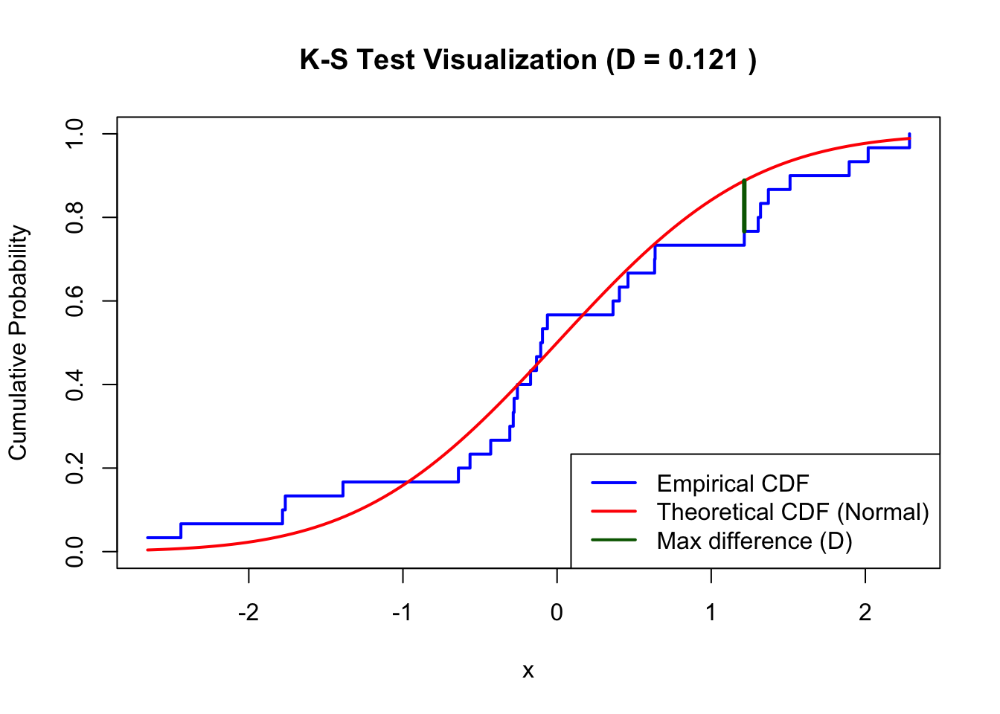

```{r}
#| label: setup
#| include: false
library(ggplot2)
library(gt)
library(scales)
library(knitr)

# ---- Load the population generators from the simulation scripts -------------
gens <- tryCatch({
  source("scripts/config.R")
  source("scripts/distributions.R")
  c(dist_normal, dist_uniform, dist_die, dist_exponential)
}, error = function(e) {
  message("Could not load scripts/: ", conditionMessage(e))
  list()
})

# ---- Settings ----------------------------------------------------------------
R           <- 10000                         # Monte Carlo repetitions (match main.R)
results_dir <- "results"                     # stats_results_<name>.csv live here
fig_dir     <- file.path(results_dir, "figures")  # <name>_hist_n<n>.png / <name>_qq_n<n>.png
N_POP       <- 50000                         # draws used to display each population
skew_tol    <- 0.5                          # normal enough: |skewness| <= 0.10
kurt_tol    <- 1                          # and |Pearson kurtosis - 3| <= 0.20

navy <- "#12263f"; blue <- "#1b4f72"; accent <- "#c8553d"; grey <- "#616e7c"

# ---- Distributions (order = order of the report) -----------------------------
meta <- data.frame(
  dist = c("normal",
           "uniform",
           "die",
           "exponential"
           ),
  label = c("Normal(0, 1)",
            "Uniform(0, 1)",
            "Six-sided die",
            "Exponential(1)"
            ),
  params = c("\u03bc = 0, \u03c3 = 1",
             "a = 0, b = 1",
             "Values 1\u20136, equally likely",
             "\u03bb = 1 (mean = 1)"
             ),
  gen = c("rnorm(n, 0, 1)",
          "runif(n, 0, 1)",
          "sample(1:6, n, replace = TRUE)",
          "rexp(n, rate = 1)"
          ),
  trait = c("Normal",
            "Bounded, symmetric, non-normal",
            "Discrete uniform",
            "Strong right skewed"
            ),
  discrete = c(FALSE, FALSE, TRUE, FALSE),
  stringsAsFactors = FALSE
)

# ---- Load the simulation results ---------------------------------------------
files <- list.files(results_dir, pattern = "^stats_results_.*\\.csv$", full.names = TRUE)
stopifnot("No stats_results_*.csv files found in results/. Run scripts/main.R first." = length(files) > 0)
res <- do.call(rbind, lapply(files, function(f) {
  d <- read.csv(f)
  d$dist <- sub("^stats_results_(.*)\\.csv$", "\\1", basename(f))
  d
}))
res <- merge(res, meta[, c("dist", "label")], by = "dist", all.x = TRUE)
res <- res[res$dist %in% meta$dist, , drop = FALSE]
res$label[is.na(res$label)] <- res$dist[is.na(res$label)]
res <- res[order(match(res$dist, meta$dist), res$n), ]
res$normal_enough <- abs(res$Skewness) <= skew_tol & abs(res$Kurtosis - 3) <= kurt_tol

# Smallest n that is normal enough and stays so for all larger n tested
stable_n <- function(d) {
  d <- d[order(d$n), ]
  ok <- sapply(seq_len(nrow(d)), function(i) all(d$normal_enough[i:nrow(d)]))
  if (any(ok, na.rm = TRUE)) min(d$n[which(ok)]) else NA_real_
}

# ---- Theoretical (or simulated) population mean and SD ----------------------
pop_draws <- lapply(setNames(meta$dist, meta$dist), function(d) {
  g <- gens[[d]]
  if (is.null(g)) return(NULL)
  tryCatch(as.numeric(g(N_POP)), error = function(e) NULL)
})
exact <- list(normal = c(0, 1), uniform = c(0.5, sqrt(1 / 12)), die = c(3.5, sqrt(35 / 12)),
              exponential = c(1, 1))
pop_info <- do.call(rbind, lapply(meta$dist, function(d) {
  if (!is.null(exact[[d]]))
    return(data.frame(dist = d, mu = exact[[d]][1], sigma = exact[[d]][2], src = "exact"))
  x <- pop_draws[[d]]
  if (is.null(x))
    return(data.frame(dist = d, mu = NA_real_, sigma = NA_real_, src = "unavailable"))
  data.frame(dist = d, mu = mean(x), sigma = sd(x), src = "simulated")
}))

# ---- Shared helpers ------------------------------------------------------------
theme_conf <- function(base = 12) {
  theme_minimal(base_size = base, base_family = "sans") +
    theme(
      plot.title      = element_text(face = "bold", colour = navy, size = base + 2),
      plot.subtitle   = element_text(colour = grey, margin = margin(b = 8)),
      axis.title      = element_text(colour = grey, size = base - 1),
      axis.text       = element_text(colour = "#3e4c59"),
      panel.grid.minor = element_blank(),
      panel.grid.major = element_line(colour = "#e4e7eb", linewidth = .3),
      strip.text      = element_text(face = "bold", colour = navy, hjust = 0),
      strip.background = element_blank(),
      legend.position = "bottom",
      legend.title    = element_blank(),
      plot.title.position = "plot"
    )
}

style_gt <- function(g, size = 13) {
  g |>
    tab_options(table.font.size = px(size),
                column_labels.background.color = navy,
                row_group.background.color = "#eef2f7",
                row_group.font.weight = "bold",
                table.width = pct(100),
                data_row.padding = px(4)) |>
    tab_style(style = cell_text(color = "white", weight = "bold"),
              locations = cells_column_labels())
}

# p-values as text so very small values never break a table
fmt_p <- function(p) ifelse(is.na(p), "—", ifelse(p < 0.001, "<0.001", sprintf("%.3f", p)))
p_cols <- c("SW_p", "Lillie_p", "AD_p", "DP_p")

col_labels <- c(label = "Distribution", n = "n", Mean = "Mean", Median = "Median",
                SD = "SD (sim. SE)", Skewness = "Skew", Z_s = "Z skew",
                Kurtosis = "Kurt", Z_k = "Z kurt", SW_p = "Shapiro p",
                Lillie_p = "Lilliefors p", AD_p = "A–D p", DP_p = "D'Ag.–P. p",
                Ok = "Normal enough?")

# ---- Choose which n to show in each distribution's histogram/Q-Q/table -------
pick_n <- function(d) {
  ns <- sort(unique(res$n[res$dist == d]))
  if (length(ns) <= 4) return(ns)
  sort(unique(c(min(ns), ns[which.min(abs(ns - 30))], ns[ceiling(length(ns) / 2)], max(ns))))
}
n_show <- list()   # override per distribution, e.g. n_show$exponential <- c(1, 10, 30, 100)
get_n  <- function(d) if (!is.null(n_show[[d]])) n_show[[d]] else pick_n(d)
```

```{r}
#| label: plot-helpers
#| include: false

# Population plot: a large simulated draw from the generator, with mu and sigma in the subtitle
plot_population <- function(d) {
  x <- pop_draws[[d]]
  if (is.null(x))
    return(ggplot() + theme_void() +
             labs(title = "Population draws unavailable (check that scripts/ loads)"))
  info <- pop_info[pop_info$dist == d, ]
  lab  <- meta$label[meta$dist == d]
  disc <- meta$discrete[meta$dist == d]
  sub  <- if (is.na(info$mu)) "Mean undefined (no finite mean); display clipped to [-20, 20]"
          else sprintf("μ = %.3f, σ = %.3f (%s)", info$mu, info$sigma, info$src)
  p <- ggplot(data.frame(x = x), aes(x))
  p <- if (disc) p + geom_bar(aes(y = after_stat(prop), group = 1), fill = blue, width = 0.8)
       else p + geom_histogram(aes(y = after_stat(density)), bins = 60, fill = blue,
                               colour = "white", linewidth = .2)
  if (!is.na(info$mu)) p <- p + geom_vline(xintercept = info$mu, colour = accent,
                                           linetype = 2, linewidth = .8)
  p + labs(title = paste("Population:", lab), subtitle = sub, x = "Value",
           y = if (disc) "Probability" else "Density") +
    theme_conf(11)
}

# How the mean, median, skewness, kurtosis (and SE) change with n
plot_convergence <- function(d) {
  x <- res[res$dist == d, ]
  x <- x[order(x$n), ]
  info <- pop_info[pop_info$dist == d, ]
  pan <- c("Mean and median", "Skewness", "Kurtosis", "Standard error of the mean")
  long <- rbind(
    data.frame(n = x$n, panel = pan[1], series = "Mean",         value = x$Mean),
    data.frame(n = x$n, panel = pan[1], series = "Median",       value = x$Median),
    data.frame(n = x$n, panel = pan[2], series = "Skewness",     value = x$Skewness),
    data.frame(n = x$n, panel = pan[3], series = "Kurtosis",     value = x$Kurtosis),
    data.frame(n = x$n, panel = pan[4], series = "Simulated SE", value = x$SD))
  if (!is.na(info$sigma))
    long <- rbind(long, data.frame(n = x$n, panel = pan[4],
                                   series = "Theory σ/√n", value = info$sigma / sqrt(x$n)))
  long$panel <- factor(long$panel, levels = pan)
  ref <- data.frame(panel = factor(c(pan[2], pan[3]), levels = pan), y = c(0, 3))
  if (!is.na(info$mu))
    ref <- rbind(ref, data.frame(panel = factor(pan[1], levels = pan), y = info$mu))
  bands <- data.frame(panel = factor(c(pan[2], pan[3]), levels = pan),
                      lo = c(-skew_tol, 3 - kurt_tol), hi = c(skew_tol, 3 + kurt_tol))
  theory <- "Theory σ/√n"
  cols <- setNames(c(blue, accent, "#5e548e", "#2a9d8f", blue, accent),
                   c("Mean", "Median", "Skewness", "Kurtosis", "Simulated SE", theory))
  ltys <- setNames(c(1, 2, 1, 1, 1, 2),
                   c("Mean", "Median", "Skewness", "Kurtosis", "Simulated SE", theory))
  ggplot(long, aes(n, value, colour = series, linetype = series)) +
    geom_rect(data = bands, aes(xmin = -Inf, xmax = Inf, ymin = lo, ymax = hi),
              inherit.aes = FALSE, fill = "#2a9d8f", alpha = .12) +
    geom_hline(data = ref, aes(yintercept = y), inherit.aes = FALSE,
               colour = grey, linewidth = .4, linetype = 3) +
    geom_line(linewidth = .8) + geom_point(size = 1.8) +
    facet_wrap(~ panel, ncol = 2, scales = "free_y") +
    scale_x_log10(breaks = c(1, 5, 10, 30, 100, 300, 1000), labels = comma) +
    scale_colour_manual(values = cols) +
    scale_linetype_manual(values = ltys) +
    labs(x = "Sample size n (log scale)", y = NULL) +
    theme_conf(11)
}

# Pull in the PNGs exported by main.R: histogram then Q-Q plot for each n
show_hist_qq <- function(d, ns = get_n(d)) {
  ns <- as.integer(ns)
  f <- as.vector(rbind(file.path(fig_dir, sprintf("%s_hist_n%d.png", d, ns)),
                       file.path(fig_dir, sprintf("%s_qq_n%d.png",   d, ns))))
  miss <- f[!file.exists(f)]
  if (length(miss))
    message("Missing figure(s): ", paste(basename(miss), collapse = ", "),
            "  -> export PNGs from scripts/main.R")
  f <- f[file.exists(f)]
  if (!length(f)) return(invisible(NULL))
  knitr::include_graphics(f)
}

# Formal normality diagnostics for the selected n
stats_table <- function(d, ns = get_n(d)) {
  x <- res[res$dist == d & res$n %in% ns, ]
  cols <- intersect(c("n", "Mean", "SD", "Skewness", "Z_s", "Kurtosis", "Z_k", p_cols), names(x))
  df <- x[, cols, drop = FALSE]
  for (v in intersect(p_cols, names(df))) df[[v]] <- fmt_p(df[[v]])
  gt(df) |>
    cols_label(.list = as.list(col_labels[names(col_labels) %in% names(df)])) |>
    fmt_number(columns = any_of(c("Mean", "SD", "Skewness", "Kurtosis", "Z_s", "Z_k")),
               decimals = 3) |>
    fmt_integer(columns = "n") |>
    style_gt(12)
}
```

```{r}
#| label: report-inputs
#| include: false
# ---- EDIT HERE: your judgement calls ------------------------------------------
# Smallest n you defend as normal enough. NA = use the automatic rule from setup.
n_final <- setNames(rep(NA_real_, nrow(meta)), meta$dist)
# n_final["exponential"] <- 100

# One-line key observation per distribution for the summary table
key_obs <- setNames(rep("(add)", nrow(meta)), meta$dist)
# key_obs["normal"] <- "Normal at every n, as theory predicts"
```

# Executive Summary

## Central Limit Theorem

Let $X_1, X_2, ..., X_n$ be a random sample from a distribution. The Central Limit Theorem (CLT) states that if the sample size $n$ is "sufficiently large," then the sampling distribution of the sample mean $\bar{X}$ follows an approximate normal distribution with $E[\bar{X}] = \mu$ and $Var(\bar{X}) = \sigma^2/n$.


$$
Z_n = \frac{\bar{X}_n - \mu}{\sigma/\sqrt{n}} \;\xrightarrow{d}\; N(\mu , \frac{\sigma}{\sqrt{n}})
$$

The sample size $n$ to which the sampling distribution yields adequately "normal" depends on the shape of the population distribution 

::: finding-grid
::: {.finding .fast}
<div class="tag">Fast</div>
<div class="big">n ≤ 10</div>
<p>Symmetrical, light-tailed, unimodal/continuous</p>
<p>Distributions: Normal, Uniform, Binomial Large</p>
:::
::: {.finding .mod}
<div class="tag">Moderate</div>
<div class="big">n ≈ 30</div>
<p>Discrete or lightly skewed</p>
<p>Distributions: Die, Exponential, Poisson, Binomial Small</p>
:::
::: {.finding .slow}
<div class="tag">Slow</div>
<div class="big">n ≫ 30</div>
<p>Heavily skewed</p>
<p>Distributions: Poison</p>
:::
::: {.finding .fail}
<div class="tag">Fails</div>
<div class="big">N/A</div>
<p>Heavy-tailed and/or Violate theorem's assumption.</p>
<p>Distributions: Cauchy (no finite mean); Dependent.</p>
:::
:::

The CLT describes the sampling distribution of the mean regardless of the underlying population distribution. However, the theorem makes several assumptions about the sampled observations, and violating them may not yield normal results:

- Observations are independent
- Observations are identically distributed
- The population distribution has a finite mean $\mu$
- The population distribution has a finite variance $\sigma^2$


### Goal

This project tries to solve the following questions:

1. The smallest $n$ which CLT yields normal enough sampling distribution?
3. Criteria to determine a distribution is adequately normal
2. How do population shape and discreteness affect the rate of convergence?
3. Which conditions does CLT fail?

## Approach

For each tested population distribution, `r format(R, big.mark = ",")` Monte Carlo repetitions were conducted for sequence of sample size $n$. Each repetition produced one sample mean, allowing the resulting empirical sampling distributions to be evaluated for their progression toward normality as $n$ increased.

Descriptive statistical summaries **(mean, standard error, skewness, kurtosis)**, graphical diagnostics **(historgram and Q-Q plot)**, and four formal normality tests **(Shapiro-Wilk, Kolmogorov-Smirnov with Lilliefors correction, Anderson-Darling, D'Agostino-Pearson)** used to identify a sufficiently normal approximation.

## Summary Table

The table below gives the smallest sample size $n$ at which the sampling distribution of the mean is judged normal enough, along with the summary statistics of the sample means at that $n$. See the [Results](#results) section for more detailed statistics.

```{r}
#| label: tbl-summary
#| tbl-cap: "Smallest sample size judged normal for each distribution, with the summary statistics"
summ <- do.call(rbind, lapply(meta$dist, function(d) {
  x <- res[res$dist == d, ]
  if (!nrow(x)) return(NULL)
  x <- x[order(x$n), ]
  chosen <- if (!is.na(n_final[d])) n_final[[d]] else stable_n(x)
  i <- if (is.na(chosen)) which.max(x$n) else which(x$n == chosen)[1]
  if (is.na(i)) i <- which.min(abs(x$n - chosen))
  data.frame(
    Distribution   = meta$label[meta$dist == d],
    Characteristic = meta$trait[meta$dist == d],
    n_ok = as.numeric(chosen),
    Mean = x$Mean[i],
    SD   = x$SD[i],
    Skew = x$Skewness[i],
    Kurt = x$Kurtosis[i],
    stringsAsFactors = FALSE
  )
}))

g <- summ |>
  gt() |>
  cols_label(Distribution = "Distribution", Characteristic = "Characteristic",
             n_ok = "Smallest n", Mean = "Mean", SD = "Sample Standard Deviation",
             Skew = "Skewness", Kurt = "Kurtosis") |>
  fmt_number(columns = c("Mean", "SD"), decimals = 3) |>
  fmt_number(columns = c("Skew", "Kurt"), decimals = 2) |>
  fmt_integer(columns = "n_ok") |>
  sub_missing(columns = "n_ok", missing_text = "None") |>
  sub_missing(columns = c("Mean", "SD", "Skew", "Kurt"), missing_text = "—")
if (any(!is.na(summ$n_ok)))
  g <- data_color(g, columns = "n_ok",
                  fn = scales::col_numeric(c("#d8f3dc", "#fff3bf", "#ffd6c9"),
                                           domain = NULL, na.color = "#f4b6b6"))
style_gt(g, 14)
```

# Methods

## Distributions Studied

```{r}
#| label: tbl-dist
#| tbl-cap: "The populations sampled. In the generators, n is the sample size."
dist_tbl <- data.frame(Distribution   = meta$label,
                       Parameters     = meta$params,
                       Generator      = meta$gen,
                       Characteristic = meta$trait,
                       stringsAsFactors = FALSE)
dist_tbl |>
  gt() |>
  cols_label(Generator = "R generator") |>
  tab_style(style = cell_text(font = c("Fira Code", "Consolas", "monospace"), size = "small"),
            locations = cells_body(columns = "Generator")) |>
  style_gt(14)
```

## Simulation
The investigation used a Monte Carlo simulation-based experimental design to examine how the sampling distribution of the sample mean changes as the sample size, \(n\), increases. The random seed defined in `scripts/config.R` was reset before each population distribution to ensure reproducibility, regardless of the order in which distributions were tested.

For each population distribution listed in [Section 2.1](#distributions-studied), \(n\) represents the number of observations in one random sample. The appropriate random-generation function was used to generate a sample of size \(n\), and its mean was calculated. This process was repeated \(R =\), representing the number of simulation, `r format(R, big.mark = ",")` times using `replicate()`. The resulting \(R\) sample means formed the empirical sampling distribution used for analysis.

This process was repeated for each value of \(n\) in a defined sequence, varying from 1 up to 1000. Results were compared across sample sizes to identify the smallest \(n\) for which the sampling distribution appeared approximately normal.

As a quality-control check, the complete analysis was rerun using a different random seed. The results and conclusions were compared to assess the robustness of the simulation findings and the conclusions regarding the Central Limit Theorem.

## Statistical Tests

The sampling distribution of the mean was evaluated using moment-based statistics, graphical diagnostics, and formal normality tests, using the following criteria.

No universal tolerance determines when a distribution is “normal enough”; the appropriate threshold depends on the industry, application, and consequences of using a normal approximation. In this investigation, practical criteria appropriate for engineering analysis/computation and lean six-sigma were used. Conclusions were based on the combined evidence from descriptive statistics, graphical diagnostics, and formal normality tests. Therefore, a single test rejecting normality did not automatically determine the conclusion, particularly when other diagnostics suggested that the deviation was practically insignificant.

$R = `r format(R, big.mark = ",")`$ simulated sample means gives the tests substantial power to detect very small and practically unimportant departures from normality.

```{r}
#| label: tbl-diagnostics
#| tbl-cap: "Criteria used to assess whether the sampling distribution of the mean is approximately normal."

Rfmt <- format(R, big.mark = ",")

diag_tbl <- data.frame(
  Type = c(
    rep("Moment-based", 5),
    rep("Graphical", 2),
    rep("Formal", 4)
  ),

  Statistic = c(
    "Mean",
    "Median",
    "Standard deviation (`SD`)",
    "Skewness",
    "Pearson kurtosis",
    "Histogram with fitted normal curve",
    "Normal Q–Q plot",
    "Shapiro–Wilk",
    "Lilliefors-corrected KS",
    "Anderson–Darling",
    "D'Agostino–Pearson"
  ),

  Implementation = c(
    "R: `mean()`",
    "R: `median()`",
    "R: `sd()`",
    "`moments::skewness()`",
    "`moments::kurtosis()`",
    "`hist()` & `curve(dnorm(...))`",
    "`qqnorm()` & `qqline()`",
    "`stats::shapiro.test()`",
    "`nortest::lillie.test()`",
    "`nortest::ad.test()`",
    "`fBasics::dagoTest()`"
  ),

  Reference = c(
    "Theoretical population mean, μ",
    "Mean of sample distribution",
    "Theoretical standard error, σ/√n",
    "0",
    "3",
    "bell-shaped, symmetric, and unimodal",
    "a straight line",
    "≈ 1",
    "≈ 0",
    "Small A values",
    "χ² distribution with 2 dof"
  ),

  Rule = c(
    "0.5",
    "0.5",
    "0.5",
    paste0("|skewness| ≤ ", skew_tol),
    paste0("|kurtosis difference| ≤ ", kurt_tol),
    "Assess overall shape, symmetry, tails, and outliers",
    "Assess whether points follow the theoretical Q–Q line",
    "W ≥ 0.99 <br> p > 0.05",
    "D close to 0 <br> p > 0.05",
    "Smaller A <br> p > 0.05",
    "χ² ≤ 5.991 <br> p > 0.05"
  ),

  Note = c(
    "Measures centering and does not establish normality by itself",
    "A large mean–median difference may indicate asymmetry",
    paste0(
      "The usual σ/√n formula may not apply to dependent, ",
      "non-identical, or heavy-tailed observations"
    ),
    paste0(
      "The code also calculates SE_skew = √(6/R) and its Z-score. ",
      "The Z-score is supporting evidence because R = ",
      Rfmt,
      " makes it sensitive to small departures"
    ),
    paste0(
      "Pearson kurtosis is used, so the normal reference is 3. ",
      "The code also calculates SE_kurt = √(24/R) and its Z-score"
    ),
    "Small, unsystematic deviations are acceptable",
    "Systematic curvature or large tail departures suggest non-normality",
    paste0(
      "A random sample of up to 5,000 observations is used because ",
      "`shapiro.test()` has a 5,000-observation limit. The p-value is ",
      "supporting evidence because R = ",
      Rfmt,
      " is large"
    ),
    "The Lilliefors correction accounts for estimating the normal mean and standard deviation from the data",
    "The Anderson–Darling test places greater weight on tail departures",
    "Combines skewness and kurtosis; the p-value is supporting evidence rather than the sole decision rule"
  ),

  stringsAsFactors = FALSE
)

diag_tbl |>
  gt(groupname_col = "Type") |>
  cols_label(
    Statistic = "Test",
    Implementation = "R code",
    Reference = "Normal reference",
    Rule = "Tolerance or decision rule",
    Note = "Special consideration"
  ) |>
  fmt_markdown(
    columns = c("Statistic", "Implementation", "Reference", "Rule", "Note")
  ) |>
  cols_width(
    Statistic ~ pct(15),
    Implementation ~ pct(15),
    Reference ~ pct(19),
    Rule ~ pct(22),
    Note ~ pct(22)
  ) |>
  style_gt(13)
```

### Moment-Based Statistics

The **mean (`Base R::mean()`)** of the simulated sample means was compared with the theoretical population mean when that value was available and the **median `Base R::median()`** of the simulated sample means. Normal distribution is symmetric and has equal mean and median. These measures describe the center of the sampling distribution but do not establish normality by themselves.

The **standard deviation (`Base R::SD()`)** of the simulated sample means estimates the standard error of the sample mean. For independent and identically distributed observations with finite variance, the **theoretical standard error (SE)** is $\sigma/\sqrt{n}$. The standard error check is that the simulated SD should match SE. Close agreement supports the independence, identical-distribution, and finite-variance assumptions; a clear gap indicates that the usual formula does not describe the sampling distribution, as expected for dependent, non-identical, or heavy-tailed populations.

Mean, median, and standard deviation are all calculated from base R package library.

For a normal distribution, **skewness (`skewness()`)** is $0$ and **Pearson ( `kurtosis()`)** is $3$. The analysis therefore evaluates whether the absolute skewness is within `r skew_tol` and whether the absolute difference between Pearson kurtosis and $3$ is within `r kurt_tol`.

Skewness and kurtosis were calculated using the `moments` library package.

### Graphical Tests

The **histogram (`hist()`)** was used to assess whether the sampling distribution appeared approximately unimodal, symmetric, and bell-shaped. A fitted normal density curve was added using the simulated mean and standard deviation.

The normal **Q–Q plot (`qqnorm()`)** was used to assess whether the ordered sample means followed an approximately straight-line pattern. Small, unsystematic deviations are acceptable, but systematic curvature or large tail departures suggest non-normality.

### Formal Normality Tests

The  **Shapiro–Wilk (SW) (`shapiro.test()`)** test, from the `stats` library, compares the ordered sample observations with the expected order statistics from a normal distribution and summarizes their agreement with the \(W\)-statistic. Values of \(W\) closer to \(1\) indicate strong overlap with the normal bell curve and Q-Q plot. The statistic provides a numerical supplement to the visual histogram and Q–Q plot.

Because this function accepts no more than 5,000 observations, a random sample of up to 5,000 simulated sample means was selected without replacement using `sample()`.

The null hypothesis is that the simulated sample means come from a normal distribution. A \(p\)-value greater than \(0.05\) indicates insufficient evidence to reject this hypothesis.

The **Lilliefors-corrected Kolmogorov–Smirnov (KS) test** (`lillie.test()`), from the `nortest` library, compares the empirical cumulative distribution function (CDF) of the simulated sample means with the CDF of a fitted normal distribution. The Lilliefors correction accounts for the fact that the normal distribution’s mean and standard deviation are estimated from the data rather than known in advance.

The \(D\)-statistic is the maximum absolute vertical difference between the empirical CDF and the fitted normal CDF. It summarizes the largest discrepancy but does not identify its location or cause. Therefore, a large \(D\)-statistic may reflect a localized deviation, such as a tail discrepancy or outlying observations, and should be interpreted alongside the histogram, Q–Q plot, and other normality diagnostics.

p-value for this test serve same function as the Shapiro–Wilk test.

```{r}
#| label: fig-ks-test
#| fig-cap: "Illustration of the Lilliefors-corrected Kolmogorov–Smirnov test."
#| fig-alt: "Empirical and fitted normal cumulative distribution functions used to calculate the KS statistic."
#| out-width: 50%


```

The **Anderson–Darling (AD) test** (`ad.test()`), from `nortest` library, also compares the empirical CDF with the fitted normal CDF, but it applies greater weight to discrepancies in the distribution tails. The $A$-statistic also outputs a single point of greatest difference.

Because the tails receive greater weight, a deviation near the tails can produce a relatively large $A$-statistic even when the center of the distribution appears approximately normal. The test is also sensitive to the large number of simulated sample means, so small departures from normality may produce small $p$-values. Therefore, the AD test was treated as supporting evidence and interpreted alongside the graphical diagnostics and other normality measures.

p-value for this test serve same function as the Shapiro–Wilk test.

The **D’Agostino–Pearson omnibus test(`dagoTest()`)**, from the `fBasics` library, jointly evaluates skewness and kurtosis to assess whether the simulated sample means are consistent with a normal distribution. It combines the standardized skewness and kurtosis statistics:

$$
K^2 = Z_{\text{skew}}^2 + Z_{\text{kurt}}^2,
$$

which approximately follows a chi-square distribution with 2 degrees of freedom under the null hypothesis of normality. Using a 95% significance level, $\chi^2_{0.95,2}=5.991.$

Because the simulation contains 10,000 sample means, the test may detect small departures from normality, including slight skewness or tail differences. For some populations, the sampling distribution’s skewness and kurtosis may converge slowly—or not converge fully—to the normal benchmarks of 0 and 3, respectively. If these deviations remain within the predefined practical tolerances, the sampling distribution may still be treated as approximately normal for this investigation, if supported by other tests.

p-value for this test serve same function as the Shapiro–Wilk test.

::: {.callout-warning appearance="simple"}
## Summary notes p-values
Because $R = `r format(R, big.mark = ",")`$, these tests have high statistical power and may reject normality for small deviations that are not practically important. The p-values were therefore treated as supporting evidence rather than as automatic decision rules. The primary assessment used the mean, standard error, skewness, kurtosis, histogram, Q–Q plot, and consistency of the results across increasing values of $n$.
:::


# Results

## All Statistics

```{r}
#| label: tbl-detail
#| tbl-cap: "Every statistic for every population and sample size. A check mark means that row meets the normal-enough thresholds."
detail <- res
detail$Ok <- ifelse(detail$normal_enough, "✓", "")
dcols <- intersect(c("label", "n", "Mean", "Median", "SD", "Skewness", "Z_s", "Kurtosis",
                     "Z_k", p_cols, "Ok"), names(detail))
dd <- detail[, dcols, drop = FALSE]
dd$label <- as.character(dd$label)
for (v in intersect(p_cols, names(dd))) dd[[v]] <- fmt_p(dd[[v]])
gt(dd, groupname_col = "label") |>
  cols_label(.list = as.list(col_labels[names(col_labels) %in% names(dd) & names(col_labels) != "label"])) |>
  fmt_number(columns = any_of(c("Mean", "Median", "SD", "Skewness", "Kurtosis", "Z_s", "Z_k")),
             decimals = 3) |>
  fmt_integer(columns = "n") |>
  style_gt(12)
```

## Normal(0, 1)

### Description

**Prediction before running.** *(What do you expect for this population, and why?)*

```{r}
#| label: fig-pop-normal
#| fig-cap: "Population distribution for Normal(0, 1) (50,000 simulated draws). The dashed line marks the mean."
#| fig-height: 3.4
plot_population("normal")
```

### Convergence of the Mean, Median, Skewness and Kurtosis

```{r}
#| label: fig-conv-normal
#| fig-cap: "How the sampling distribution of the mean changes with n for Normal(0, 1). Shaded bands mark the normal-enough tolerance; dotted lines mark the target for a normal distribution."
#| fig-height: 6.5
plot_convergence("normal")
```

*(Describe how each statistic changes with n and when it enters the tolerance band.)*

### Histograms and Q–Q Plots

```{r}
#| label: fig-hq-normal
#| fig-cap: "Histogram (left) and normal Q–Q plot (right) of the sample means at selected n."
#| layout-ncol: 2
show_hist_qq("normal")
```

*(Interpret the shape of the histogram and the Q–Q plot at each n.)*

### Formal Test Results

```{r}
#| label: tbl-stats-normal
#| tbl-cap: "Normality diagnostics for Normal(0, 1) at the selected n."
stats_table("normal")
```

**Chosen n and justification.** *(The smallest n you defend as normal enough, supported by the evidence above.)*

**What surprised me.** *(At least one feature of this simulation you did not expect.)*

## Uniform(0, 1)

### Description

**Prediction before running.** *(What do you expect for this population, and why?)*

```{r}
#| label: fig-pop-uniform
#| fig-cap: "Population distribution for Uniform(0, 1) (50,000 simulated draws). The dashed line marks the mean."
#| fig-height: 3.4
plot_population("uniform")
```

### Convergence of the Mean, Median, Skewness and Kurtosis

```{r}
#| label: fig-conv-uniform
#| fig-cap: "How the sampling distribution of the mean changes with n for Uniform(0, 1). Shaded bands mark the normal-enough tolerance; dotted lines mark the target for a normal distribution."
#| fig-height: 6.5
plot_convergence("uniform")
```

*(Describe how each statistic changes with n and when it enters the tolerance band.)*

### Histograms and Q–Q Plots

```{r}
#| label: fig-hq-uniform
#| fig-cap: "Histogram (left) and normal Q–Q plot (right) of the sample means at selected n."
#| layout-ncol: 2
show_hist_qq("uniform")
```

*(Interpret the shape of the histogram and the Q–Q plot at each n.)*

### Formal Test Results

```{r}
#| label: tbl-stats-uniform
#| tbl-cap: "Normality diagnostics for Uniform(0, 1) at the selected n."
stats_table("uniform")
```

**Chosen n and justification.** *(The smallest n you defend as normal enough, supported by the evidence above.)*

**What surprised me.** *(At least one feature of this simulation you did not expect.)*

## Six-sided die

### Description

**Prediction before running.** *(What do you expect for this population, and why?)*

```{r}
#| label: fig-pop-die
#| fig-cap: "Population distribution for Six-sided die (50,000 simulated draws). The dashed line marks the mean."
#| fig-height: 3.4
plot_population("die")
```

### Convergence of the Mean, Median, Skewness and Kurtosis

```{r}
#| label: fig-conv-die
#| fig-cap: "How the sampling distribution of the mean changes with n for Six-sided die. Shaded bands mark the normal-enough tolerance; dotted lines mark the target for a normal distribution."
#| fig-height: 6.5
plot_convergence("die")
```

*(Describe how each statistic changes with n and when it enters the tolerance band.)*

### Histograms and Q–Q Plots

```{r}
#| label: fig-hq-die
#| fig-cap: "Histogram (left) and normal Q–Q plot (right) of the sample means at selected n."
#| layout-ncol: 2
show_hist_qq("die")
```

*(Interpret the shape of the histogram and the Q–Q plot at each n.)*

### Formal Test Results

```{r}
#| label: tbl-stats-die
#| tbl-cap: "Normality diagnostics for Six-sided die at the selected n."
stats_table("die")
```

**Chosen n and justification.** *(The smallest n you defend as normal enough, supported by the evidence above.)*

**What surprised me.** *(At least one feature of this simulation you did not expect.)*

## Exponential(1)

### Description

**Prediction before running.** *(What do you expect for this population, and why?)*

```{r}
#| label: fig-pop-exponential
#| fig-cap: "Population distribution for Exponential(1) (50,000 simulated draws). The dashed line marks the mean."
#| fig-height: 3.4
plot_population("exponential")
```

### Convergence of the Mean, Median, Skewness and Kurtosis

```{r}
#| label: fig-conv-exponential
#| fig-cap: "How the sampling distribution of the mean changes with n for Exponential(1). Shaded bands mark the normal-enough tolerance; dotted lines mark the target for a normal distribution."
#| fig-height: 6.5
plot_convergence("exponential")
```

*(Describe how each statistic changes with n and when it enters the tolerance band.)*

### Histograms and Q–Q Plots

```{r}
#| label: fig-hq-exponential
#| fig-cap: "Histogram (left) and normal Q–Q plot (right) of the sample means at selected n."
#| layout-ncol: 2
show_hist_qq("exponential")
```

*(Interpret the shape of the histogram and the Q–Q plot at each n.)*

### Formal Test Results

```{r}
#| label: tbl-stats-exponential
#| tbl-cap: "Normality diagnostics for Exponential(1) at the selected n."
stats_table("exponential")
```

**Chosen n and justification.** *(The smallest n you defend as normal enough, supported by the evidence above.)*

**What surprised me.** *(At least one feature of this simulation you did not expect.)*

# Discussion

## Is n = 30 a Universal Rule?

*(Answer with evidence from the summary table and figures.)*

## How Population Shape Affects Convergence

*(Which populations converged fastest and slowest, and why: skewness, discreteness, tails.)*

## Scope of the Current Report

This version examines four independent, identically distributed populations with finite variance: Normal, Uniform, a six-sided die, and Exponential. Dependent, non-identical, and heavy-tailed populations will be added in a later version.

## Limitations

- The sample sizes tested form a grid, so the "smallest n" is resolved only to that grid.
- The tolerance thresholds are a judgment call.
- All results are Monte Carlo estimates with sampling error (SE of skewness ≈ `r round(sqrt(6 / R), 3)`).

## Practical Guidance

*(What a practitioner should do when choosing a sample size.)*

# Conclusion

*(Summarize the answer to the three guiding questions and state your overall conclusion about the n = 30 rule.)*

# Appendix {.appendix}

## Scripts

```{r}
#| label: appendix-scripts
#| results: asis
#| echo: false
fence <- strrep("`", 3)
script_files <- c("setup.R", file.path("scripts", c("config.R", "distributions.R",
                  "distribution_generators.R", "main.R")))
script_files <- script_files[file.exists(script_files)]
for (f in script_files) {
  cat("\n::: {.callout-note collapse=\"true\"}\n## ", f, "\n\n", sep = "")
  cat(fence, "r\n", paste(readLines(f, warn = FALSE), collapse = "\n"), "\n", fence, "\n", sep = "")
  cat(":::\n\n")
}
```

## Results Folder

```{r}
#| label: appendix-results
#| echo: false
fs <- list.files(results_dir, recursive = TRUE)
kable(data.frame(
  `File type` = c("Statistics tables (CSV)", "Diagnostic plot books (PDF)",
                  "Histogram and Q-Q figures (PNG)"),
  Count = c(sum(grepl("\\.csv$", fs)), sum(grepl("\\.pdf$", fs)), sum(grepl("\\.png$", fs))),
  Location = c("`results/stats_results_<name>.csv`", "`results/normality_plots_<name>.pdf`",
               "`results/figures/<name>_hist_n<n>.png`, `<name>_qq_n<n>.png`"),
  check.names = FALSE), align = "lrl")
```

## AI Prompts for This Project

```{r}
#| label: appendix-ai
#| results: asis
#| echo: false
if (file.exists("ai_prompts.md")) {
  cat(readLines("ai_prompts.md", warn = FALSE), sep = "\n")
} else {
  cat("*Create `ai_prompts.md` in the project root with your prompts, follow-up prompts, ",
      "and how you checked or corrected the results. It is included here automatically.*")
}
```

## Sources

*Check each entry against your own sources before submitting.*

- Anderson, T. W., & Darling, D. A. (1952). Asymptotic theory of certain "goodness of fit" criteria based on stochastic processes. *Annals of Mathematical Statistics, 23*(2), 193–212.
- D'Agostino, R., & Pearson, E. S. (1973). Tests for departure from normality. *Biometrika, 60*(3), 613–622.
- Lilliefors, H. W. (1967). On the Kolmogorov–Smirnov test for normality with mean and variance unknown. *Journal of the American Statistical Association, 62*(318), 399–402.
- Shapiro, S. S., & Wilk, M. B. (1965). An analysis of variance test for normality (complete samples). *Biometrika, 52*(3–4), 591–611.
- Labmeier, G. *Project 1: How Fast Does Normal Happen?* and *CLT Project 1: What I Am Looking For* (course materials).
- R Core Team. *R: A Language and Environment for Statistical Computing.* R Foundation for Statistical Computing, Vienna, Austria.
- R packages: moments, nortest, fBasics, ggplot2, gt, scales, knitr.

## Session Information

```{r}
#| label: session
sessionInfo()
```
